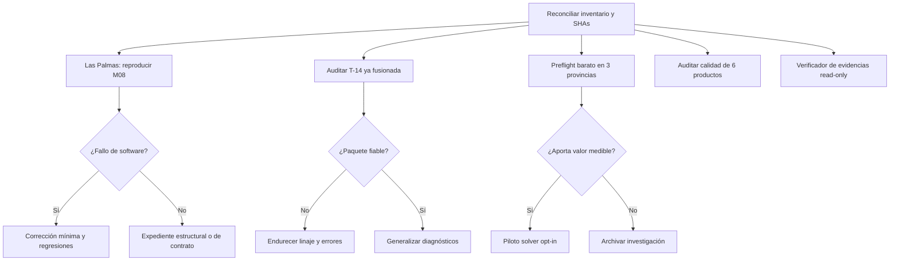

# DDD — Plan de ingeniería verificable y cierre nacional
## Versión 2.0 · Arquitectura, diagnóstico, factibilidad, calidad, evidencia y método de ejecución

**Proyecto:** Diputado de Distrito — `jfmurciego/DiputadodeDistrito`  
**Versión:** `2.0.0` · **Fecha:** 2 de noviembre de 2026 · **Tipo:** plan técnico y operativo de decisión  
**Estado:** **PROPUESTA PARA DIRECCIÓN. No es una orden de modificar código, fusionar PR, lanzar runs ni publicar.**  
**Propietario de decisiones reservadas:** Jesús · **Dirección operativa:** Work  
**Ejecutor principal previsto:** Claude Code · **Revisión técnica:** agente independiente, sin escritura durante el dictamen  
**Documento anterior:** `DDD_PLAN_ARQUITECTURA_FACTIBILIDAD_CALIDAD_EVIDENCIAS_2026-11-02.md` v1.0.0  
**Repositorio:** <https://github.com/jfmurciego/DiputadodeDistrito>

> **Tesis de la V2:** el mayor rendimiento de DDD ya no procede de aumentar la producción de PR y ejecuciones, sino de **reducir el coste del error**, separar la certificación de la calidad, identificar las restricciones estructuralmente incompatibles y conservar una procedencia comprobable de cada producto. Esta versión sustituye un programa de 17 tareas casi simultáneas por **un camino crítico corto, experimentos de adopción con presupuesto y ampliaciones estrictamente condicionadas a resultados**.

---

# 0. Ficha de decisión: qué hacer ahora y qué no hacer

## 0.1 Decisión recomendada a Work

**GO de planificación y diagnóstico de solo lectura; no GO de implementación indiscriminada.**

Tres entregas priorizadas, en este orden de dependencias:

1. **DDD-REC-01 — Reconciliación forense de la cadena nacional y las publicaciones.** Congelar la referencia Git exacta, producto vigente y último intento de cada ámbito; eliminar contradicciones entre dashboard, manifiestos y visor.
2. **DDD-INC-01 — Las Palmas, validación M08 posterior a la PR #394.** Reproducir la misma puerta y los mismos bytes que fallaron, identificar la regla realmente violada o el defecto del validador y proponer una corrección mínima.
3. **DDD-DIAG-01 — Endurecimiento posfusión de T-14 / PR #397.** Demostrar que un diagnóstico contiene únicamente archivos del mismo linaje y puede recuperarse sin perder el error original.

En paralelo **solo en lectura**: preparar un pequeño estudio de factibilidad de **Madrid y Málaga**, sin iniciar un solver de ámbito nacional. No introducir una nueva puerta obligatoria de generación, un nuevo almacén operativo ni una migración del visor hasta superar las pruebas piloto.

## 0.2 Criterio de inversión

| Decisión | Se hace ahora | Se aplaza hasta obtener evidencia |
|---|---|---|
| Reproducir una puerta exacta con producto M06 reutilizado | Sí | — |
| Corregir una causa raíz demostrada con test rojo/verde | Sí, tras encargo y permisos | — |
| Hacer completos los diagnósticos de fallos | Sí, en piloto | Migración general de evidencia |
| Preflight aritmético y de componentes sin efectos sobre M04 | Sí, piloto | Solver CP-SAT/MILP general |
| Métricas de calidad sobre productos ya certificados | Sí, lectura | Optimizar geometrías por un índice nuevo |
| Cambiar suelo, techo, K, atomicidad o exenciones | No | Decisión específica del propietario |
| Repetir 00 como herramienta de depuración | No | Solo validación final autorizada |
| Refactorizar todos los workflows y persistencia | No | Demostración de ahorro y compatibilidad |

## 0.3 Cuáles son las novedades sustantivas de esta versión

- **Corte actualizado:** la **PR #397 está fusionada** (commit de merge `92b221f28167cebcebf502d51d5a925bf78f93bb` del 1-11-2026, 23:02:48 UTC). La #396 también está fusionada. El problema de T-14 es ahora de **aceptación posintegración**, no de autorización para fusionar esa PR.
- **Modelo económico de experimentación:** cada investigación tiene presupuesto inicial, condiciones de parada y medida explícita de ahorro; no se construye un subsistema porque sea intelectualmente atractivo.
- **Lógica de pruebas matemática reforzada:** un modelo *relajado* puede demostrar inviabilidad del contrato completo; un modelo **más restrictivo** no. Se formalizan las direcciones correctas de implicación para no generar falsos `INFEASIBLE`.
- **Diagnóstico causal, no especulativo:** Las Palmas incorpora un árbol de hipótesis falsables, la matriz de datos exactos y pruebas negativas; no se declara culpable a la PR #394 sin reproducirla.
- **Trazabilidad sensible a cambios:** se separan identidad de fuente, contrato materializado, política, motor, validador, checkpoint y bytes del producto; se definen reglas de invalidación y de preservación de productos válidos.
- **Camino crítico mínimo:** cuatro resultados exigibles antes de ampliar un programa; el resto queda en un catálogo de oportunidades condicionado por GO técnico.
- **Integración con el gobierno real:** no sustituye `docs/PLAN.md` ni la metodología de operador único y autorizaciones vigentes; los IDs nuevos son alias propuestos y deben asignarse definitivamente por el planificador.

---

# 1. Alcance, jerarquía de fuentes y fotografía de partida

## 1.1 Qué se ha verificado y qué no

**Corte de repositorio consultado:** último commit visible `92b221f28167cebcebf502d51d5a925bf78f93bb`; los dos últimos cambios conocidos son #396 y #397 fusionadas. **Corte del estado durable:** `orchestracion/estado_operativo.json`, generado el `2026-11-01T22:23:42.208962+00:00`, anterior a esos merges.

| Indicador de la fotografía | Valor | Alcance de la afirmación |
|---|---:|---|
| Territorios catalogados | 71 | 19 autonómicos y 52 nacionales |
| Cadenas completas registradas | **61** | 18 autonómicas y 43 nacionales |
| Productos territoriales certificados | **63** | No todos tienen incorporación electoral completa |
| Cadenas completas con `PASS` estricto territorial | **12** | Basado en clasificación del registro durable, no auditoría nueva de cada excepción |
| Cadenas completas con excepciones gobernadas | **49** | No equivalen a 49 defectos: requieren expedientes válidos |
| Ámbitos sin certificación territorial | **8** | Andalucía y siete nacionales |
| Entradas del registro de visor | **133** | 55 ámbitos distintos; no equivalen a 133 publicaciones desplegadas |

**Diez ámbitos sin cadena completa en esa fotografía:** Andalucía; Nacional Alicante, Islas Baleares, Barcelona, Cádiz, Madrid, Málaga, Murcia, Las Palmas y Cantabria. Los dos últimos ya tenían producto territorial registrado. **No atribuir el mismo estado a un momento posterior sin regenerar el inventario.**

**Run crítico de Las Palmas:** `41358199178`, ejecutado sobre un `source_sha` posterior a #394. Su manifiesto registra `territorial_status=CERTIFIED`, `electoral_status=INCOMPLETE`, `status=FAILED`; la fase de incorporación electoral falla. El log indica que M07 y la generación M08 producen salidas, pero la validación posterior termina con `distritos bajo límite poblacional=1`. No significa que el producto electoral quedara certificado.

**Estado de T-14:** PR #397 fusionada en `main`; su descripción declara 2.072 tests correctos y 20 omitidos. **No consta en las evidencias inspeccionadas que haya superado una prueba productiva controlada de fallo**; la suite verde no acredita por sí sola dicha prueba.

## 1.2 Precedencia y autoridad

1. **Evidencias inmutables de ejecución:** bytes, hashes y manifiestos de los jobs efectivos; commits exactos, no ramas móviles.
2. **Código, contrato materializado, política, catálogo y workflow que consumió el run.** Un YAML actual puede diferir del que vio el contenedor antiguo.
3. **Certificaciones y registro durable**, con distinción entre estado derivado y hechos de producto.
4. **Gobierno** (`DDD_GOBIERNO.md`, `AGENTS.md` cuando corresponda), `CLAUDE.md`, `docs/PLAN.md`, decisiones identificadas y `docs/REGISTRO_DE_CAMBIOS.md`.
5. **Este plan**, subordinado a las anteriores.

`DDD_CONTINUIDAD.md` es una fotografía del 27 de septiembre y no prevalece sobre GitHub. La V1 tampoco prevalece sobre la V2 cuando existan contradicciones demostradas. En cualquier sesión posterior se debe ejecutar la comprobación de actualidad antes de hacer afirmaciones sobre el estado de una PR.

## 1.3 Invariantes del producto

- El cálculo de límites territoriales **no** utiliza resultados electorales para elegir geometrías. M07/M08 incorporan elecciones a una partición territorial ya definida.
- Cada sección tiene identidad inequívoca y una sola asignación; poblaciones y totales deben conservarse según el contrato.
- El universo autonómico y el nacional son diferentes: compartir módulos no autoriza mezclar K, fuentes, catálogo, períodos ni excepciones.
- Conectividad, puentes oficiales o gobernados, integridad provincial, disciplina municipal, componentes físicas, suelo y techo se aplican según contrato y edición exactos.
- Una excepción **autorizada, delimitada y vigente** no es una violación arbitraria; tampoco es un `PASS` estricto.
- `RUN_SUCCESS`, `TERRITORIAL_CERTIFIED`, `ELECTORAL_CERTIFIED`, `PRODUCT_REGISTERED` y `VIEWER_PUBLISHED` son estados independientes.
- El último intento fallido **no sobrescribe** un producto certificado previo ni equivale a su revocación automática.
- Nadie modifica políticas, fusiona, lanza procesos productivos o publica sin la autorización aplicable. Work prioriza y revisa; el propietario decide las acciones reservadas.

## 1.4 Diagrama realista del flujo y de sus fallos

```text
       ENTRADAS OFICIALES + IDENTIDAD DE EDICIÓN
                         │
               M01 / M02 / M03
                         │
               [preflight ligero]
                         │
                      M04 / M05
                         │
           M06 + certificación territorial
                         │
         Producto territorial durable (M06)
                         │
  elecciones + fuentes → M07 → M08 → validación M08
                                        │
                           Producto electoral durable
                                        │
                        promoción y publicación 05
                                        │
                                 visor común

   Cada flecha tiene SHA, contrato, puerta, evidencia y decisión.
   Un fallo solo afecta al intento y a sus salidas no certificadas.
```

**Aclaración terminológica:** los nombres de workflow visibles `02 · Generación de Distritos Autonómicos` y `04 · Incorporar Resultados Electorales` son heredados y pueden procesar provincias nacionales. El modelo lógico no debe inferir el universo por la etiqueta visible del workflow; usa `territory_id` y contrato.

---

# 2. Arquitectura de ejecución: dos velocidades y cinco puertas

## 2.1 Evitar el error de la V1

La V1 proponía 17 paquetes de trabajo encadenados. Como mapa de arquitectura es útil, pero como dirección del proyecto genera un **segundo backlog gigante** cuando DDD está cerca de completar numerosos territorios. La V2 separa:

- **Carril A — cierre del producto existente (prioridad máxima):** reparar validaciones, conservar evidencias, desbloquear productos, reconciliar estado y publicación.
- **Carril B — capacidad futura con prueba de valor:** preflight matemático, auditoría de calidad, laboratorio de experimentación y eventual evolución de persistencia.

El carril B **no puede retener personal ni bloquear el carril A** salvo si descubre un riesgo de integridad que lo haga inseguro. Las excepciones se documentan como decisiones, no como logros del motor.

## 2.2 Las cinco puertas

| Puerta | Pregunta | Evidencia y rechazo |
|---|---|---|
| **G0 · Integridad de entrada** | ¿Son consistentes edición, fuentes, CUSEC, grafo, contrato, política y SHA? | Manifiesto validado; `INPUT_INVALID` si falta identidad o hay discrepancia |
| **G1 · Prueba técnica** | ¿El cambio reproduce un defecto y lo corrige sin regresiones? | Test rojo/verde, unitarios, integraciones, CI de HEAD exacto y revisión independiente |
| **G2 · Certificación territorial** | ¿M06 cumple las restricciones vigentes, y cuáles son las excepciones? | Auditoría del producto exacto; PASS, PASS_WITH_GOVERNED_EXCEPTIONS, BLOCK |
| **G3 · Certificación electoral** | ¿M07/M08 incorpora fuentes y resultados compatibles con el M06 exacto? | Totales, identidad de elección y producto, validación M08, hash y registro |
| **G4 · Publicación** | ¿Es el mismo producto certificado que se promueve y muestra? | Registro de versión, manifiesto de visor, verificación del activo publicado y rollback |

Ninguna puerta se aprueba por la simple presencia de un commit, un test unitario, una PR fusionada o una conclusión `SUCCESS` del workflow contenedor.

## 2.3 Estado mínimo que debe manejar la dirección

**Intento:** `PLANNED | RUNNING | SUCCEEDED | FAILED | CANCELLED`.  
**Producto:** `ABSENT | GENERATED | VALIDATED | REJECTED | SUPERSEDED`.  
**Certificación:** `NOT_EVALUATED | PASS | PASS_WITH_GOVERNED_EXCEPTIONS | BLOCK | UNKNOWN`.  
**Publicación:** `NOT_REQUESTED | CANDIDATE | PUBLISHED | WITHDRAWN`.  
**Tarea:** `READY | REPRODUCING | IMPLEMENTING | REVIEW | WAIT_OWNER | CLOSED | BLOCKED`.

Estos ejes no se compactan en un solo estado `COMPLETO` para consumo técnico. El dashboard público podrá simplificar, pero siempre ofrecerá detalle trazable.

---

# 3. Expediente P0 — Nacional Las Palmas: fallo real de M08

## 3.1 Hechos observados (no hipótesis)

- Run: <https://github.com/jfmurciego/DiputadodeDistrito/actions/runs/41358199178>.
- Manifiesto durable: `territorios/congreso_las_palmas/evidencia/ejecuciones_completas/41358199178.json`.
- En el manifiesto, **M06 se reutiliza** del run `41336103808`; se registra certificado territorial (`PASS_WITH_EXCEPTIONS`), no se regenera.
- M07 devuelve `OK ... unassigned_votes=0`; M08 genera `..._m08_distritos_resultados.geojson.zip` y posteriormente la validación da `distritos bajo límite poblacional=1`, código de salida 3.
- La PR #394 ya estaba fusionada al producirse ese intento: había añadido tratamiento de identificadores municipales de la forma `35012:35-C01` y recálculo de exenciones por secciones.
- El contrato actual de Las Palmas contiene `validation.population_floor_exempt_municipalities: ['35012']` y usa `DDD_MUNICIPALITY_PARTITION` en M04–M06. Tiene K=10, suelo 0,85 y techo 1,40 de la media en el contrato consultado. **Estas cifras actuales deben cotejarse con el contrato materializado realmente consumido por el run.**
- **Anomalía de configuración que merece prueba específica:** el contrato consultado declara `territory_contract.population_floor_exempt_partitions: [35-C02]`, mientras que `validation.population_floor_exempt_partitions: []`. Puede ser una distinción deliberada entre preparación y validación o una pérdida de propagación; **no se presume que sea un bug** hasta trazar qué campo consume cada módulo.
- En esa misma fotografía, `municipality_atomicity_limit_ratio: 1.15` aparece junto al techo `population_cap_ratio: 1.40` y a `oversized_municipality_rule: split_only_above_hard_cap`. Se debe comprobar la precedencia real de estas reglas antes de atribuir un bloqueo a la disciplina municipal.

## 3.2 Árbol de hipótesis y pruebas que las refutan

| Hipótesis de fallo | Test discriminante | Qué NO demostraría |
|---|---|---|
| H1. El contrato materializado por M08 no contiene la exención | Obtener exactamente el YAML del contenedor y evaluar `validation.population_floor_exempt_municipalities` | Que el YAML de `main` contenga 35012 |
| H2. El campo municipal usado por el validador no es `DDD_MUNICIPALITY_PARTITION` o su valor difiere | Volcar `mun_field`, columnas reales y códigos del distrito rechazado | Que el helper aislado maneje bien la cadena `35012:35-C01` |
| H3. El distrito bajo suelo **no contiene 35012** y el fallo es legítimo | Tabla por distrito: población, floor efectivo, municipios y particiones | Que un territorio posea alguna exención en otro distrito |
| H4. La excepción aplicada por M06 no se transmite a M08 | Comparar filas `population_floor`, secciones, resumen M06 y validador M08 sobre idénticos bytes | Que ambos módulos estén en la misma versión nominal |
| H5. La verificación ejecuta código o configuración diferente de la PR #394 | Comparar SHA del checkout ejecutor, imagen/entrypoint y funciones cargadas en contenedor | Que el run haya arrancado después del merge |
| H6. `territory_contract` declara exención `35-C02` y `validation` la deja vacía | Comparar semántica, materialización, precedencia y lector de exenciones por componente en cada puerta | Que una discrepancia textual entre secciones del YAML sea, por sí sola, un fallo |
| H7. El producto reutilizado quedó obsoleto respecto de la política o edición | Evaluar huellas compatibles y reglas de invalidación del checkpoint | Que «reutilizar» equivalga a producto vigente automáticamente |

**Prioridad forense:** primero H3 (¿cuál es el distrito y contiene el municipio exento?), después H1/H2/H4 y la discrepancia `35-C02` de H6; las demás según evidencia. Evita asumir que el software tiene un bug cuando el rechazo puede estar previsto por las reglas.

## 3.3 Secuencia de diagnóstico de lectura

1. Registrar `main_sha`, `run_id`, `source_sha` y commit exacto de **cada job que produjo y validó M08**. El branch `main` no sirve como referencia retrospectiva.
2. Descargar o recuperar **solo** los artefactos mínimos del run M06 `41336103808`, del M08 `41358199178` y la certificación/política/contrato consumidos. Si una evidencia falta, registrar `MISSING_EVIDENCE`, no reconstruirla de otra edición.
3. Comprobar SHA-256, tamaño y nombres declarados en el manifiesto. El producto M06 tiene una identidad distinta de un M08 fallido aún no certificado.
4. Obtener para cada distrito del M08: población agregada exacta, suelo normal, suelo efectivo, exención aplicada (`municipio`, `partición`, `ninguna`), conjunto de municipios y secciones. Distinguir las exenciones por **pertenencia** de una autorización general.
5. Reproducir **solo el validador** (`herramientas/validar_ejecucion.py`) en un entorno equivalente, con configuración y ficheros congelados, sin llamar a 00, M04 ni M05.
6. Identificar una única causa raíz o emitir `INDETERMINATE` con razón concreta. Construir fixture mínimo conservando el caso real de regresión.
7. Si se confirma defecto de código, demostrar **rojo en el código previo y verde en el corregido**; añadir prueba negativa que rechace un municipio o componente sin exención.
8. Solo después: PR acotada, revisor independiente, CI, autorización de merge y verificación de `main`; para la prueba productiva, solicitar autorización explícita del propietario y reutilizar el producto existente cuando sea compatible.

## 3.4 Tabla diagnóstica obligatoria

| Campo | Tipo | Regla |
|---|---|---|
| `district_id` | cadena estable | Identidad encontrada en M06/M08, no índice adivinado |
| `population` | entero | Suma estricta de secciones, sin nulos ni duplicidades |
| `target`, `floor_default`, `cap` | numéricos | Derivados del contrato materializado |
| `municipalities` | conjunto ordenado | Códigos INE de cinco cifras, conservando valor de campo original |
| `partitions` | conjunto ordenado | Identidad exacta del lookup que vio el run |
| `exemptions_matched` | lista | Explicitar clase, fundamento, edición y alcance |
| `floor_effective` | numérico | Calcular en el mismo punto que el validador efectivo |
| `expected_decision` | `PASS/BLOCK` | Derivada de contrato, no de lo deseado para el territorio |
| `actual_decision` | `PASS/BLOCK` | Salida cruda de validación |
| `origin_product_sha256` | SHA-256 | Producto M06/M08 efectivamente evaluado |

## 3.5 Criterio de cierre de DDD-INC-01

**Éxito mínimo de diagnóstico:** identificar si el rechazo es correcto o incorrecto, y producir expediente reproducible. **Éxito de reparación:** en caso de defecto real, el mismo producto pasa todas las validaciones sin elevar límites ni modificar exenciones, y una prueba negativa sigue fallando correctamente. Si el rechazo es legítimo, cerrar investigación con una demostración y transferir a estudio de factibilidad: **no fabricar un PASS**.

**Parada inmediata:** discrepancia de hashes, producto que no corresponde al run, política incierta, evidencia esencial inaccesible o cambio de edición. Se conserva un `NO_GO_EVIDENCE` hasta obtener esa evidencia.

---
# 4. Expediente P0 — Diagnóstico automático T-14 después de fusionar #397

## 4.1 Situación real y alcance del cambio propuesto

La PR <https://github.com/jfmurciego/DiputadodeDistrito/pull/397> ya se integró mediante `92b221f28167cebcebf502d51d5a925bf78f93bb`. Añadió `herramientas/publicar_diagnostico_auto.py` y pasos de fallo en `_reutilizable-generacion-territorial.yml`. Selecciona M01, grafo M03 e informe M05 desde la caché, comprime el grafo, aplica un techo de 50 MiB y publica en la rama `diagnostico/auto/<territorio>/<run>/`. El archivo `ORIGEN.txt` contiene únicamente territorio y run. El helper opera en modo best-effort para no ocultar el fallo original.

**Decisión:** no deshacer la mejora sin prueba, pero tampoco certificarla por una suite verde. Abrir una tarea de **endurecimiento de producto integrado** solo si la auditoría confirma que persisten los riesgos identificados. La meta no es «reescribir T-14», sino **convertir la salida en evidencia fiable y su fallo en un evento visible**.

## 4.2 Anomalías verificadas en el código consultado

| ID | Punto del código | Problema preciso | Riesgo | Prueba requerida |
|---|---|---|---|---|
| T14-01 | `_latest(cache, patterns)` | Escoge por `mtime`, sin asociar ficheros a una identidad de checkpoint | Mezcla M01/M03/M05 incompatibles | Dos checkpoints intencionalmente intercalados; rechaza mezcla |
| T14-02 | `collect()` | Si falta un fichero, avisa y continúa con los restantes | Diagnóstico parcial presentado como recuperable | Falta M03; salida formal `PARTIAL`, sin promesa de reproducción |
| T14-03 | `ORIGEN.txt` | Solo guarda `run` y `territorio` | No puede demostrarse identidad byte-a-byte del motor/contrato | Manifiesto con hashes y entradas declaradas |
| T14-04 | `publish()` | Ejecuta `git rebase` sin comprobar su `returncode` | Estado Git dudoso y retries poco fiables | Conflicto inducido y verificación de abort/rollback |
| T14-05 | `main()` | Excepciones degradadas a warning y salida 0 sin estado durable | El diagnóstico desaparece sin seguimiento | Estado `DIAG_PUBLISH_FAILED` observable en el run |
| T14-06 | Activación `if: failure()` | Solo cubre determinados puntos de la cadena | Fallos elegibles no siempre dejan paquete | Matriz de fallos por M04, M05 y puerta de certificación |
| T14-07 | Rama pública `diagnostico/auto` | Exposición de archivos brutos sin declaración de sensibilidad | Custodia inadecuada si el paquete contiene datos no publicables | Inventario de contenidos y test de allowlist |
| T14-08 | Límite 50 MiB | Se limita el tamaño de salidas, pero no se exige integridad del conjunto | Paquete esencial incompleto o imposible de recuperar | Caso que rebasa límite y conserva fallo de empaquetado |

Estos puntos no acreditan que haya existido un paquete mezclado o una pérdida de datos real. **Son propiedades y riesgos concretos de la implementación** que deben probarse antes de confiar en ella como fuente de verdad.

## 4.3 Diseño mínimo del manifiesto `ddd.diagnostic-bundle/1.0`

```json
{
  "schema": "ddd.diagnostic-bundle/1.0",
  "bundle_id": "<hash-del-manifiesto-canonico>",
  "territory_id": "congreso_las_palmas",
  "attempt": {
    "workflow_run_id": 41358199178,
    "job_id": null,
    "stage": "M05",
    "failed_step": "<nombre-registrado>",
    "source_commit": "<sha40-del-job>"
  },
  "lineage": {
    "m01_origin_run_id": null,
    "m03_origin_run_id": null,
    "m05_origin_run_id": null,
    "checkpoint_id": "<id-exacto-si-existe>",
    "resolved_contract_sha256": "<sha256>",
    "policy_sha256": "<sha256>",
    "graph_definition_sha256": "<sha256>"
  },
  "files": [
    {
      "role": "M01_SECTIONS",
      "path": "<nombre-relativo>",
      "sha256": "<sha256>",
      "size_bytes": 0,
      "origin_run_id": null
    }
  ],
  "completeness": "PARTIAL",
  "missing_required_roles": ["M03_GRAPH", "M05_REPORT"],
  "publication": {
    "status": "NOT_ATTEMPTED",
    "location": null,
    "published_at": null
  },
  "created_at": "<ISO-8601-UTC>"
}
```

**Nota de contrato:** los datos entre `<...>` representan campos a rellenar por la implementación; no son un manifiesto real. Para un `COMPLETE`, exigir los roles que **corresponden a la etapa**: si falla M04 no siempre puede existir informe M05. Evitar la contradicción de exigir M05 cuando aún no se ha ejecutado; la completitud es una función de `failed_stage` y del conjunto mínimo de reproducción.

**Clave de diseño:** el `bundle_id` se obtiene de una serialización canónica y sin autorreferencia. El hash de archivos es de los **bytes originales o claramente del derivado comprimido**; si ambos se conservan, deben figurar los dos. Nunca llamar `sha256` al SHA Git de un blob sin especificar el tipo de huella.

## 4.4 Reglas de asociación de entradas

- No usar el `mtime` como criterio autoritativo. Obtener los archivos desde el índice/checkpoint de ejecución y su manifiesto durable, identificando a qué run y contrato pertenece cada uno.
- Si el checkpoint actual reutiliza un M01 de otro run, declararlo explícitamente: **misma ejecución no significa mismo run de origen**, sino **linaje compatible demostrado**.
- La asociación es una función de identidades: edición, `territory_id`, CUSEC, grafo, parámetros, contrato efectivo, policy, motor y reglas de invalidez. Si no puede demostrarse, salida `DIAGNOSTIC_PARTIAL_UNTRUSTED`.
- Descomprimir y validar una muestra estructural sin necesidad de procesar toda la geometría durante el empaquetado: columnas exigidas, identidad del territorio, número de registros, huella declarada y presencia de todos los ficheros requeridos para la etapa.
- Preservar original de M03 y `sha256` del comprimido; indicar algoritmo, nivel y versión o tratar la compresión como derivación sin semántica.

## 4.5 Máquina de estados del diagnóstico

```text
FAILURE_DETECTED
   ├─ INPUTS_AVAILABLE → COLLECTING → LINEAGE_VALIDATED
   │                                   ├─ COMPLETE → PUBLISHING → PUBLISHED
   │                                   └─ PARTIAL  → PUBLISHING → PUBLISHED_PARTIAL
   ├─ INPUTS_MISSING → PARTIAL / NOT_AVAILABLE
   └─ PACKAGE_ERROR → PUBLISH_FAILED (con causa)
```

Un diagnóstico fallido **no debe reemplazar el exit code de M04/M05**, pero debe quedar una anotación estructurada con `diagnostic_status`, razón e ID para el sistema de incidencias. La regla de observabilidad es: **best-effort para la cadena principal; fail-visible para el diagnóstico**.

## 4.6 Concurrencia y Git

Si se mantiene temporalmente el almacenamiento en rama:

1. El staging trabaja en directorio aislado; no ejecuta `git reset` sobre el worktree del repositorio.
2. El push usa una identidad de objeto inmutable (`territorio/run/attempt`) y rechazo si otro proceso intenta escribir bytes distintos en la misma ruta.
3. Si un push falla, se diferencia rechazo no-fast-forward, credencial, ruleset, cuota y conflicto.
4. Solo rebase **cuando es una operación válida**; revisar el código de retorno. Si falla, abortar y no empujar una rama ambigua.
5. Evitar borrar expedientes concurrentes; introducir verificación posterior del manifiesto publicado por hash.
6. Definir un límite de intentos y estado final visible. Un retry ilimitado ocultaría conflictos reales y consumiría créditos.

**Alternativa preferente a evaluar, no a adoptar automáticamente:** almacenamiento de objetos versionado o artefactos asociados al run con retención y copia durable, conservando en Git solo índice y referencias. La rama `diagnostico/auto` es una solución provisional útil, no necesariamente la arquitectura definitiva.

## 4.7 Matriz de aceptación que faltaba en V1

| Ensayo | Entrada | Resultado obligatorio |
|---|---|---|
| INT-01 | Fallo M04 previo a M05 | Paquete mínimo de esa etapa, estado correcto, sin inventar M05 |
| INT-02 | Fallo M05 con tres archivos compatibles | `COMPLETE`, hashes verificables, reconstrucción aislada |
| INT-03 | Dos checkpoints, `mtime` cruzado | No mezclar archivos; o rechazar con causa |
| INT-04 | Falta grafo M03 | `PARTIAL/NOT_AVAILABLE`; no anunciar reproducción completa |
| INT-05 | Falla solo la certificación posterior | Mantener diagnóstico y producto previo, sin ocultar el error |
| INT-06 | Run terminado correctamente | No generar expediente de fallo |
| INT-07 | Dos runs concurrentes del mismo territorio | Conservar dos expedientes y no sobrescribir |
| INT-08 | `git rebase` con conflicto | Rechazo limpio y evidencia del error, sin push inconsistente |
| INT-09 | Paquete >50 MiB | Rechazo o estrategia aprobada, nunca truncado silencioso |
| INT-10 | Archivo con contenido no permitido | Rechazo antes de publicarlo en rama pública |
| INT-11 | Test en runner real **autorizado** con fallo inyectado | Reproducibilidad local confirmada, no solo test de remoto bare |

**Puerta de salida:** los once ensayos documentados o un NO-GO explícito por limitación de infraestructura; no aceptar solo el número de tests totales como sustituto.

---

# 5. Factibilidad antes de optimización: proyecto piloto, no plataforma completa

## 5.1 La pregunta que sí merece dinero de ingeniería

> «¿Qué parte de los bloqueos de población puede demostrarse inevitable bajo las reglas aprobadas, y qué parte depende de los movimientos o del presupuesto del algoritmo actual?»

Los runs que agotaron `population_repair` sin mejoras no contestan por sí mismos esta pregunta: **no encontrar solución no demuestra que no exista**. La primera aportación matemáticamente útil es un conjunto de **certificados de condiciones necesarias**, no un solver masivo.

## 5.2 Reglas que deben modelarse antes de evaluar factibilidad

El informe debe referenciar por ID y versión cada restricción. En el diseño inicial:

`R-COV` asignación completa de todas las unidades; `R-DISJ` unicidad; `R-K` número de distritos; `R-PROV` frontera provincial; `R-COMP` particiones físicas y agrupaciones autorizadas; `R-CONN` contigüidad en el grafo aprobado; `R-POP-FLOOR` suelo; `R-POP-CAP` techo; `R-MUN-ATOMIC` disciplina municipal y divisiones necesarias; `R-BRIDGES` aristas declaradas válidas; `R-FIXED` asignaciones o unidades congeladas; `R-EDITION` coherencia de fuentes; `R-EXCEPT` excepciones vigentes por regla y ámbito.

**Prohibición:** cambiar implícitamente qué se considera unidad atómica para hacer resoluble el modelo. Si el motor permite una macro-unidad variable, debe representarse su estructura y reglas en el mismo contrato que recibe M04.

## 5.3 Pruebas aritméticas de coste casi cero

Sea `P` la población total, `K` el número de distritos y `L`, `U` los límites de suelo/techo estrictos, **sin excepciones**. Una condición necesaria es:

\[
K L \le P \le K U.
\]

Si hay excepciones de suelo por distrito o partición, esta desigualdad **no se aplica ingenuamente**: se calculan sumas de límites efectivos `Σ L_d` y `Σ U_d` solo cuando las identidades de distrito y sus condiciones de exención estén definidas ex ante. Si la exención depende del contenido de un distrito, se necesita una variable o comprobación condicional: no se puede fijar `L_d=0` a posteriori para fabricar factibilidad.

Para una componente conexa obligatoria `C` de población `P_C`, que recibe `K_C` distritos enteramente contenidos:

\[
\left\lceil \frac{P_C}{U} \right\rceil \le K_C \le
\left\lfloor \frac{P_C}{L} \right\rfloor,
\]

siempre que **sean aplicables esos límites a todos sus distritos**, exista una partición independiente y no haya excepciones. Si el contrato permite una agrupación marítima, la componente que debe analizarse es el grafo **después de añadir solo las aristas válidas**, no una conectividad ficticia.

Ejemplos de condiciones necesarias adicionales:

- Unidad **obligatoriamente indivisible** con población mayor que `U`: contradicción con cualquier distrito que la contenga, salvo excepción de techo expresamente aplicable.
- Componente aislada cuyo mínimo de distritos supera su máximo permitido por K: imposible bajo la separación exigida.
- Unidad terminal que solo conecta con un municipio indivisible: comprobar las combinaciones admisibles; una suma mayor que `U` **solo demuestra imposibilidad si la obligación de agrupar está acreditada**.
- Municipios cerrados de frontera: usar análisis de componentes biconexas, articulaciones y separadores para identificar conjuntos que no pueden transferirse sin perder conexión.
- Cota de capacidad de vecindarios: si una subregión solo puede conectarse al resto mediante un conjunto pequeño de unidades que no se pueden cortar, formular su necesaria asignación conjunta.

**Disciplina del razonamiento:** registrar literalmente las premisas y la consecuencia. Una observación de «M05 no halló movimiento» es un `SEARCH_FAILURE`, no una prueba matemática.

## 5.4 Clasificador antes del solver

| Código | Pregunta | Salida segura |
|---|---|---|
| `DATA_INCONSISTENT` | ¿Hay sumas, ediciones, IDs o grafo incompatibles? | Detener evaluación; corregir evidencia de entrada |
| `STRUCTURAL_ARITHMETIC_CONTRADICTION` | ¿Una condición necesaria demuestra contradicción? | `INFEASIBLE` **solo si se demuestra que las premisas coinciden con el contrato** |
| `STRUCTURAL_TOPOLOGY_CANDIDATE` | ¿Hay cuello de botella o separación que merece modelado? | `UNKNOWN`, hipótesis dirigida |
| `HEURISTIC_LOCAL_MINIMUM` | ¿No existen movimientos en el vecindario actual, pero hay otros posibles? | `UNKNOWN`, no «imposible» |
| `MODELLED_FEASIBLE_WITNESS` | ¿Existe una asignación concreta y válida? | `FEASIBLE` tras pasar validador independiente |
| `PROVEN_INFEASIBLE` | ¿El solver prueba inviabilidad sobre un modelo válido para inferir la original? | `INFEASIBLE` con certificado y cobertura |
| `RESOURCE_LIMIT` | ¿Agotó tiempo o memoria? | `UNKNOWN` y métrica de coste |

## 5.5 Teorema práctico: qué tipo de modelo puede probar qué

Sea `F` el conjunto de particiones que cumplen el **contrato completo**.

**Modelo relajado:** si quitamos restricciones y obtenemos un conjunto `R` tal que `F ⊆ R`, entonces **`R = ∅` implica `F = ∅`**. Una inviabilidad probada en la relajación correctamente definida **sí** demuestra inviabilidad del original. Pero una solución de `R` puede violar restricciones omitidas y **no** es automáticamente testigo válido del contrato.

**Modelo restringido:** si añadimos restricciones y obtenemos `S ⊆ F`, entonces **`S ≠ ∅` implica `F ≠ ∅`** (si el testigo supera validación del contrato), pero **`S = ∅` no implica `F = ∅`**. Esta distinción impide concluir falsamente que una provincia es imposible por congelar demasiado el exterior de una componente.

**Modelo equivalente:** cuando `E = F` y el solver acredita inviabilidad, el contrato es inviable. Esta equivalencia debe auditarse, especialmente en contigüidad, divisibilidad municipal, particiones físicas y exenciones condicionales.

Este principio es más importante que elegir CP-SAT o MILP. Los estados de CP-SAT deben conservarse sin colapsar `UNKNOWN` en `INFEASIBLE`: la documentación oficial distingue precisamente `FEASIBLE`, `INFEASIBLE`, `OPTIMAL`, `MODEL_INVALID` y `UNKNOWN`.

Referencia técnica: <https://developers.google.com/optimization/cp/cp_solver/>.

## 5.6 Prototipo de modelo opcional (solo si el nivel barato aporta valor)

Variables binarias `x[u,d]` para asignar unidades `u` a distritos `d`, con `Σ_d x[u,d] = 1`. Restricciones de cobertura, K y población como enteros exactos (CP-SAT emplea restricciones enteras). El componente de contigüidad requiere una formulación válida: flujo por distrito, cortes separadores o **lazy cuts** con verificación iterativa externa. No limitarse a que cada unidad tenga algún vecino asignado: esa propiedad **no garantiza conectividad global**.

Para población:

\[
P_d = \sum_u p_u x_{u,d}.
\]

Con exenciones predeterminadas y plenamente justificadas se aplican `L_d ≤ P_d ≤ U_d`. Con exenciones que dependen de pertenencia municipal, introducir indicadores `z[d,m]` y condiciones de activación que reflejen exactamente la decisión institucional. No condicionar el suelo al mero resultado de un selector sin probar su elegibilidad.

La disciplina municipal puede requerir variables auxiliares para número de distritos por municipio, límite de divisiones, distritos mixtos y protección de municipios bajo techo. Una formulación simplificada que ignore una de esas condiciones solo es una **relajación marcada como parcial**. Los distritos se etiquetan artificialmente en el solver: incorporar reducción de simetría sin introducir una restricción sustantiva oculta.

**Testigo:** una asignación entera que se exporta en CUSEC, se convierte al formato consumible por el validador real y obtiene `PASS` sin excepciones nuevas. **Prueba negativa:** fixture con cuello de botella que el modelo relajado detecta como imposible; fixture donde el submodelo restringido es imposible pero el contrato completo sí es factible.

## 5.7 Tres pilotos y sus preguntas

| Piloto | Qué se investiga | Resultado que justificaría seguir |
|---|---|---|
| **Madrid** | Distrito 52 del diagnóstico: 181.853 frente a techo 133.943; bloque Pozuelo–Boadilla–municipio 28181 según T-02b | Certificado necesario o testigo alternativo validado, no solo más iteraciones |
| **Málaga** | Distrito 10: 161.454 frente a 134.376, composición municipal registrada en `docs/PLAN.md` | Demostrar obligación de agrupación o posibilidad de redistribución |
| **Murcia** | Relación Lorca, Águilas, Puerto Lumbreras y residuales enclavados; fallo M04 previo a M05 | Clasificar cuellos de botella y atomicidad sin forzar una excepción |

Alicante y Barcelona quedan como **validación fuera de muestra** para evitar ajustar el preflight a los mismos tres casos. La conclusión puede ser `UNKNOWN`; si la investigación demuestra que carece de utilidad incremental, no se industrializa.

## 5.8 Presupuesto experimental y umbral de adopción

Los siguientes son **límites propuestos de gasto, no estimaciones históricas del proyecto**. Work puede ajustarlos antes del piloto.

| Tramo | Presupuesto inicial máximo | Condición de salida |
|---|---|---|
| Preflight estático (3 pilotos) | 1 jornada de ingeniería acumulada; **cero** runs productivos | Un certificado correcto o una familia de bloqueos bien clasificada |
| Reproducción local con datos reales | Hasta 3 ejecuciones aisladas por piloto | Resultados estables y trazables, o abandono por falta de evidencia |
| Solver exploratorio por componente | Máximo 30 min de CPU por caso y 2 variantes modeladas | Testigo validado o prueba de inviabilidad; timeout = UNKNOWN |
| Escalado a 5 provincias | Solo por decisión tras informe de pilotos | Ahorro verificable de al menos una ejecución completa evitable **o** demostración de un bloqueo que previene cambios incorrectos |

**No adoptar un M03.5 obligatorio** si solo añade tiempo, si los casos quedan en `UNKNOWN` o si detecta contradicciones que las puertas actuales ya detectan al mismo coste. En ese caso el entregable valioso es el análisis, no otro módulo permanente.

---
# 6. Calidad de distritación: validez, excepciones, métricas y comparabilidad

## 6.1 La distinción que debe estar visible en todas las salidas

1. **Conformidad contractual estricta**: todas las reglas duras se cumplen, sin excepción que altere su umbral.
2. **Conformidad con excepciones gobernadas**: el producto cumple todas las reglas **que realmente son aplicables** una vez incorporadas excepciones previamente aprobadas y trazadas.
3. **Calidad de la solución**: comparación entre particiones admisibles mediante medidas demográficas, topológicas, geométricas y de estabilidad; no cambia por sí misma la certificación.
4. **Calidad de la evidencia**: completitud de procedencia, datos y auditoría; distinta de la calidad del mapa.

La fotografía inicial de 12 estrictos frente a 49 con excepciones sirve para plantear una **auditoría del significado de esas excepciones**. No demuestra que 49 distritaciones sean inferiores: algunas diferencias son estructura insular, otra política de K y algunas son efectos de la semántica de PASS heredada. La meta inicial no es «convertir 49 en 12 más PASS», sino que cada clasificación sea explicable.

## 6.2 Vector de calidad, fórmulas y condiciones de comparación

Sea `p_d` la población estrictamente validada del distrito `d`, `T_d` el objetivo aplicable y `n` el número de distritos comparables. Proponer:

\[
\delta_d = \frac{p_d-T_d}{T_d}; \qquad
D_{\max} = \max_d |\delta_d|; \qquad
D_{\mathrm{media}} = \frac{1}{n}\sum_d |\delta_d|.
\]

Para igualdad poblacional deben publicarse también cuantiles, distribución y distritos extremos. **No comparar directamente dos planes con distinta edición, K o definición de T sin una normalización y aviso explícitos.** Una mejora en `D_media` puede ocultar el empeoramiento de un distrito que excede un límite duro.

| Familia | Métrica propuesta | Interpretación y precaución |
|---|---|---|
| Población | `max_abs_relative_deviation` | Diferencia máxima respecto al objetivo; obliga a mostrar el peor caso |
| Población | `p95_abs_relative_deviation`, `mean_abs_relative_deviation` | Distribución; no sustituye a los límites duros |
| Población | `hard_floor_violations_non_exempt`, `hard_cap_violations_non_exempt` | Contar solo infracciones que **no** están legalmente exentas |
| Población | `soft_tolerance_outliers` | Fuera de tolerancia blanda, distinto de hard failures |
| Excepciones | `governed_exception_count`, `affected_population`, `max_exception_gap` | Publicar dimensión real y justificación; sin doble conteo |
| Municipal | `split_municipality_count`, `avoidable_split_count` | Necesita distinguir corte permitido, requerido y no autorizado |
| Territorial | `disconnected_district_count` | Contigüidad obligatoria; fallo duro, no métrica que se compense |
| Grafos | `articulation_points`, `bridge_edges` internos | Detectar distritos que dependen de un único punto/arista |
| Grafos | `governed_edge_dependency` | Número de aristas declaradas necesarias para conectar el distrito |
| Geometría | `polsby_popper` = `4πA/P²` | Comparar solo con CRS/área/perímetro apropiados y geometrías equivalentes |
| Geometría | `minimum_neck_width` exploratoria | Solo si existe cálculo robusto; no inventar ancho sobre límites cartográficos |
| Estabilidad | `assignment_change_rate` | Debe alinear etiquetas arbitrarias de distrito entre runs |
| Evidencia | `verified_manifest_coverage`, `retrievable_input_coverage` | No describen la forma de los distritos, sino la fiabilidad de su publicación |

### 6.2.1 Tratamiento de Polsby–Popper y costes topológicos

La compacidad varía inevitablemente con costas, islas, enclaves y barreras geográficas. Por ello, **no establecer un ranking territorial español único** con compacidad bruta. Crear cohortes homogéneas: continente y provincias continuas; litoral; islas con partición física; enclaves acreditados; componentes sin continuidad geométrica pero con puentes autorizados. En las últimas, la compacidad tradicional puede no resultar interpretable.

**No optimizar resultados electorales.** La construcción geométrica no debe utilizar preferencias o votos de partidos como función de aptitud. Se admite simular resultados después, para describir propiedades del sistema propuesto, con versión electoral y método documentados.

## 6.3 Diseño de una auditoría de calidad independiente

**Entrada:** M06 ya certificado, reglas y excepciones efectivas, fuentes y geometrías acreditadas.  
**Procesamiento:** recalcular métricas desde secciones, no copiar ciegamente el CSV de resumen.  
**Salida:** `ddd.quality-report/1.0`, *read-only*, asociado a `product_sha256`.

Cada métrica debe llevar `status=MEASURED | NOT_APPLICABLE | NOT_MEASURABLE`, `reason` y, cuando corresponda, nivel de incertidumbre o sensibilidad geométrica. No convertir `null` en cero. Una métrica no disponible no es una puntuación excelente ni una infracción por sí sola.

Prohibir un índice compuesto de 0–100 en la fase inicial. Primero establecer **dominancia de Pareto**, comparativas pareadas y *hard gates*. Solo si existe un caso de uso claro para ordenar soluciones, registrar un ADR de ponderaciones y un análisis de sensibilidad previo a ver resultados.

## 6.4 Exenciones: el objeto que falta en muchas auditorías

El expediente de excepción debe ser un recurso versionado con:

- `exception_id`, `territory_id`, universo, edición, tipo de regla y campo(s) del contrato aplicables.
- Ámbito estricto: municipio INE, partición física, componente o distrito **solo cuando esa identidad sea estable**.
- Fecha, actor, decisión y motivo explícito, evidencias técnicas y acto de aprobación.
- Condiciones de elegibilidad verificables: por ejemplo, que el distrito contenga un municipio exento en la misma edición.
- Vigencia e invalidación: cambian CUSEC, componente, K, población de referencia, política, geometría o condición acreditada.
- Magnitud observada: distritos afectados, población y diferencia respecto al suelo/techo no exentos.
- Justificación de por qué el ámbito es el mínimo necesario; evitar que una excepción de municipio se transforme en provincial por accidente.

### 6.4.1 Ejemplo: excepción municipal en una partición insular

```yaml
schema: ddd.exception/1.0
exception_id: example-las-palmas-municipio-35012
territory_id: congreso_las_palmas
universe: NAC
edition: "2025"
rule: R-POP-FLOOR
scope:
  municipality_codes: ["35012"]
  partition_ids: []
  district_ids: []
qualification:
  type: district_contains_municipality
  municipality_normalization: strip_partition_suffix
approval:
  decision_id: "<decisión real a enlazar>"
  evidence_ref: "<registro vigente>"
  status: REQUIRES_VERIFICATION
invalidation:
  - municipality_identity_changes
  - section_assignment_changes_scope
  - contract_or_policy_changes
  - edition_changes
```

**Es una plantilla**, no una nueva autorización ni un cambio al catálogo. En la implementación real debe utilizarse la identidad exacta de la decisión original, no este ID de ejemplo.

### 6.4.2 Reglas de no regresión

- Un municipio **no** exento que quede bajo suelo sigue bloqueando.
- Una exención de suelo **no** elimina un exceso sobre techo.
- La excepción solo opera en la edición y universo autorizados; igual código de municipio en otro contexto no la hereda sin contrato.
- La función que reconoce identificadores `CUMUN`, `DDD_MUNICIPALITY_PARTITION` o unidades M04 debe estar sometida a pruebas positivas y negativas equivalentes en M04, M06 y M08.
- Un `PASS_WITH_GOVERNED_EXCEPTIONS` siempre conserva el expediente de qué se exceptuó; no se diluye en un PASS global.

## 6.5 Piloto de auditoría

Ejecutar la nueva auditoría de calidad sobre **seis productos existentes**, dos estrictos, dos con excepciones municipales y dos insulares, elegidos tras verificar disponibilidad y SHA. Si falta evidencia, sustituir el ejemplo por otro de la misma clase y registrar la sustitución. **No rehacer las 71 cadenas para medir la calidad**: trabajar sobre productos conservados.

**GO de despliegue de métricas** si las seis auditorías son reproducibles y las métricas no modifican ninguna decisión de certificación; **NO-GO** si la comparabilidad o la procedencia resulta ambigua.

---

# 7. Banco de regresiones adversariales: demostrar que el error no vuelve

## 7.1 Tres niveles de prueba con coste creciente

**Nivel U — Unitario/sintético:** milisegundos a segundos; aislar decisiones de helper, normalizadores y contratos.  
**Nivel I — Integración real congelada:** consume artefactos seleccionados y sus hashes; exige reproducir la puerta que falló.  
**Nivel E — End-to-end autorizado:** workflow real y operación controlada, solo cuando el cambio afecta a orquestación, credenciales, publicación o recuperación.

Regla de asignación: un bug de M08 necesita U + I; un bug de concurrencia Git necesita U + I y al menos una E representativa si la infraestructura real puede cambiar el comportamiento. Evitar que cada PR pequeña active 71 ejecuciones completas.

## 7.2 Catálogo inicial, sin duplicar suites existentes

| Caso | Riesgo probado por la historia | Prueba positiva | Prueba negativa |
|---|---|---|---|
| ADV-01 Las Palmas | #394 + run 41358199178 | Exención válida sobre M08 exacto | No exento continúa bloqueado |
| ADV-02 Álava | #383 M04 multisección | Transferencia conectada, sin superar límites | Transferencia que desconecta donante se rechaza |
| ADV-03 Murcia | #383 CRS y M04 | Adyacencias con CRS acreditado | Puente/CRS incorrecto no se tolera |
| ADV-04 Islas Baleares | #370, #394 | Particiones y cuotas explícitas | Isla no autorizada no recibe puente |
| ADV-05 Santa Cruz de Tenerife | #369 | Puentes marítimos declarados | Arista entre grupos prohibidos se rechaza |
| ADV-06 Palencia y Tremp | #371, #390 | Puente acreditado y edición correcta | Puente heredado obsoleto se bloquea |
| ADV-07 Huesca | #356, #360 | Catálogo `pilot_territories` compatible con M08 | Código piloto mal formado rechazado |
| ADV-08 SHA de incorporación | #360 | M08 asociado al código efectivo | Avance de `main` no cambia identidad |
| ADV-09 00 y M06 | #389 | Encadena solo con `puerta_02=success` | `puerta_02=skipped/failure` no encadena |
| ADV-10 Infoelectoral | #362, #363 | ZIP oficial y espejo mismo digest, mesas cuadran | Mirror de hash diferente rechazado |
| ADV-11 Robótica de registro | #381, #386, #387 | Escritura idempotente autenticada | Cabecera duplicada y carrera no producen falso éxito |
| ADV-12 Checkpoint reutilizado | #387 y `CLAUDE.md` | Motor/edición/contrato compatibles | Checkpoint anterior incompatible no se promociona |
| ADV-13 Diagnóstico automático | #397 | Paquete exacto de un fallo | Paquete mezclado por `mtime` rechazado |
| ADV-14 Estado de producto | #387 | Último certificado preservado | Último run fallido no sustituye M08 previo |
| ADV-15 Techos particulares | #391 | Límite aplica a provincia autorizada | No altera un territorio colindante |
| ADV-16 Registro/publicación | Registro de visor | Hash certificado coincide con activo | Promoción de hash desconocido prohibida |

Los casos son **requisitos de diseño**; su presencia aquí no significa que exista una prueba ya implementada ni que todas sean fallos abiertos. Antes de crear nuevas pruebas buscar fixtures ya disponibles, reutilizar suites vigentes y añadir solo la cobertura que falta.

## 7.3 Tests metamórficos (más potentes que repetir fixtures)

Una prueba metamórfica modifica una entrada de una manera que **no debería** cambiar cierta propiedad; detectar cambios inesperados indica dependencia oculta.

1. **Renumeración de etiquetas de distrito:** la población, la conectividad y la validez no deben cambiar por permutar IDs arbitrarios.
2. **Orden de lectura de secciones:** reordenar filas, manteniendo identidad y contenido, no cambia sumas ni dictámenes.
3. **Representación de municipios:** `35012` y `35012:35-C01` deben reconocer correctamente el municipio base donde el contrato permita ambos formatos; no aceptar prefijos parciales.
4. **Compresión de entrada:** el mismo grafo M03 sin comprimir y comprimido debe producir contenido lógico equivalente, preservando diferencias de hash de bytes.
5. **Avance de `main`:** el registro de un producto calculado con SHA fijo no se recalcula contra un nuevo HEAD.
6. **Fallo posterior a una certificación:** un error de publicación no cambia ni destruye el certificado territorial/electoral previo.
7. **Reintento idempotente:** registrar dos veces el mismo evento no crea dos productos distintos.
8. **Parcialidad del diagnóstico:** quitar M03 del conjunto nunca puede dejar `completeness=COMPLETE`.
9. **Cambio de edición:** alterar CUSEC invalida la evidencia que dependa de esa identidad; no se reutiliza por similitud de nombre.
10. **Restricción más fuerte:** para el mismo problema y mismo K, endurecer el suelo/techo no debe ampliar el conjunto matemático de soluciones admisibles; cuidado: los resultados de un heurístico concreto no tienen por qué ser monótonos.

## 7.4 Protocolo rojo/verde para una PR correctiva

```text
A. Fijar fuente, contrato, policy, motor, validador, M06, M08 y run por SHA.
B. Reproducir exactamente la condición de fallo en base/main anterior.
C. Formular una propiedad esperada independiente de la implementación.
D. Introducir un caso negativo que prevenga una aceptación indebida.
E. Aplicar corrección mínima en nueva rama o worktree autorizado.
F. Ejecutar U → I → regresiones horizontales; registrar tiempos y logs acotados.
G. Revisor independiente comprueba *misma* entrada y diff exacto.
H. PR y CI según permisos; autorizar merge por separado.
I. Tras merge, CI de main y solo entonces E si se requiere y está autorizada.
J. Registrar producto afectado y si sus checkpoints son reutilizables.
```

**Condición de evidencia:** la prueba «roja» puede ser imposible de ejecutar si los artefactos caducaron. En ese caso se documenta reproducción sintética y la diferencia respecto al caso real; **no** afirmar reproducción exacta.

---

# 8. Identidad, manifiestos y reconstrucción: evidencia antes que infraestructura

## 8.1 Modelo conceptual mínimo

```text
SOURCE_EDITION ──┐
CONTRACT_VERSION ┼─> ATTEMPT ─> OUTPUT (M06/M08) ─> CERTIFICATION
ENGINE_SHA ──────┘                                  │
CHECKPOINT ──────┘                                   ▼
                                             PRODUCT_REGISTRATION
                                                      │
                                                      ▼
                                                PUBLICATION
```

Entidades con identidad propia:

- **`Attempt`**: workflow/run/job efectivos y resultado terminal.
- **`InputSnapshot`**: fuentes, políticas, contratos resueltos, grafo y versión ejecutada.
- **`Product`**: bytes canónicos del M06 o M08 con hash y semántica de edición.
- **`Certification`**: dictamen con validador exacto, conjunto de reglas y excepciones utilizadas.
- **`Registration`**: publicación del índice durable sobre el producto; no vuelve a certificar.
- **`Publication`**: versión pública visible, audiencia/canal, rollback y comprobación de activo.

**Invariante clave:** una `Certification` apunta al **hash del producto** evaluado y a la huella del validador y contrato; no únicamente a `territory_id` + fecha.

## 8.2 Manifiesto de producto v2: versión simple pero verificable

```json
{
  "schema": "ddd.product-evidence/2.0",
  "identity": {
    "territory_id": "congreso_las_palmas",
    "universe": "NAC",
    "edition": "2025",
    "stage": "M06",
    "election_key": null
  },
  "attempt": {
    "workflow_run_id": 41336103808,
    "job_id": null,
    "source_commit": "<sha40-del-checkout>"
  },
  "inputs": {
    "territorial_source_sha256": "<digest>",
    "m01_sha256": "<digest>",
    "m03_sha256": "<digest>",
    "resolved_contract_sha256": "<digest>",
    "policy_sha256": "<digest>",
    "engine_file_set_sha256": "<digest>",
    "checkpoint_manifest_sha256": "<digest>"
  },
  "product": {
    "sha256": "<digest-de-bytes>",
    "size_bytes": 0,
    "district_count": 10,
    "section_count": null,
    "storage_ref": "<referencia-durable>"
  },
  "certification": {
    "decision": "PASS_WITH_GOVERNED_EXCEPTIONS",
    "validator_commit": "<sha40>",
    "report_sha256": "<digest>",
    "exception_ids": []
  },
  "publication": {
    "status": "NOT_PUBLISHED",
    "campaign_id": null,
    "viewer_manifest_sha256": null
  }
}
```

**Ejemplo ilustrativo, no artefacto real:** cualquier campo con `<...>` o `null` en posición obligatoria debe rechazarse antes de registrar un producto productivo. En el diseño de implementación se usará JSON Schema y validación semántica adicional. El manifiesto no tiene por qué duplicar toda la información existente: preferir referencias al registro actual cuando sus hashes ya están acreditados.

## 8.3 Normalización de hashes: tres errores frecuentes que hay que evitar

1. **Hash de bytes vs hash de datos lógicos:** dos GeoJSON equivalentes pueden diferir en orden de claves/filas y bytes; el SHA crudo sirve para integridad del archivo, no demuestra igualdad semántica. Registrar ambas cosas solo si existe canonicalización documentada.
2. **Hash de código vs rama:** fijar commit de checkout de cada job y conjunto de ficheros de motor realmente usado, especialmente cuando un job descarga `main` más reciente para persistir.
3. **Hash de contrato fuente vs contrato materializado:** un materializador puede sobrescribir parámetros. La procedencia válida de una ejecución exige el contrato **resuelto y utilizado**, además del YAML original y la política que lo generó.

## 8.4 Matriz de invalidación y compatibilidad de checkpoints

| Cambio | ¿Requiere reevaluar M06? | ¿Requiere reevaluar M08? | Regla |
|---|---|---|---|
| Secciones/edición o población M01 | Normalmente sí | Sí, por dependencia | No se reutiliza producto territorial de otra base sin puente de equivalencia probado |
| Grafo M03 o puentes declarados | Sí para reglas de conectividad/generación afectadas | Sí si cambia validez del M06 | No mezclar redes administrativas de ediciones diferentes |
| M04 o contrato de formación inicial | Depende de la huella y compatibilidad de checkpoint gobernadas | Solo si M06 cambia o su validez deja de estar acreditada | Usar mecanismo efectivo de huellas; no asumir invalidez global por nombre de fichero |
| M05 o parámetros de optimización | Reevaluación/generación según contrato de huellas | Si M06 cambia, sí | Mantener certificaciones anteriores históricas; distinguir vigencia |
| Validador de M06 sin cambiar bytes | Revalidar certificación, no necesariamente regenerar geometría | Revalidar vínculo si se depende de esa certificación | No confundir recertificación con regeneración |
| Solo fuente/fecha electoral o mapeo mesa-sección | No debe cambiar M06 | Sí, M07/M08 | Separación de geometría y resultados electorales |
| Transformación de visor sin cambio M06/M08 | No | No necesariamente | Revalidar publicación/representación, sin recalcular distritos |
| Nueva exención de suelo | Revalidar aplicabilidad según decisión expresa | Revalidar reglas dependientes | No auto-promover un M08 rechazado |

La tabla es orientativa. El contrato de **huella real de DDD** define la decisión ejecutable y ha de tener pruebas; una migración no puede reemplazarlo sin equivalencia demostrada.

## 8.5 Reconciliación antes de construir un nuevo event store

El primer entregable no es implantar una base de eventos. Es un **reconciliador de solo lectura** sobre las fuentes actuales:

1. Recorrer los 71 IDs del catálogo maestro y validar ausencia de colisiones de universos/ediciones.
2. Identificar `latest_attempt`, `latest_validated_m06`, `latest_validated_m08`, `latest_registered`, `latest_published` **por separado**.
3. Verificar hashes, identidad de ejecución, certificados y elegibilidad de publicación; no inferir por nombre.
4. Buscar productos del registro con archivo ausente, caducado, no recuperable o digest distinto.
5. Reconstruir el número real de ámbitos publicados y productos activos en el visor, separado del número de entradas históricas.
6. Emitir `DIFF` respecto al dashboard vigente, sin escribir sobre `main`.
7. Proponer cambios únicamente para diferencias cuya causa esté acreditada.

El resultado es un CSV/JSON con 71 filas y un informe de discrepancias. **GO para registro append-only** solo si se demuestra que la reconciliación no puede resolverse adecuadamente con contratos y mecanismos existentes.

## 8.6 Invariantes de un eventual registro append-only

- Los eventos se incorporan una sola vez por clave idempotente `(territory_id, stage, product_sha256, event_type, certification_sha256)` según tipo de evento. No reducir todos a una misma clave.
- El orden observable es por causalidad/`parent_event_id`, no solo timestamp; relojes pueden diferir.
- Un evento de fallo no borra producto; uno de anulación no elimina prueba histórica.
- Se conserva la referencia a la versión de regla aplicada en el momento de certificación.
- El dashboard es vista derivada y reconstruible; no autoridad para reescribir hechos antiguos.
- La publicación se congela mediante un **manifest de release** que fija productos exactos y hash de salida.
- Las migraciones poseen `dry-run`, reconciliación cruzada, doble lectura temporal y rollback.

No iniciar migración mientras las carreras de escritura actuales puedan resolverse con un punto único de registro y contratos estables. La meta es simplificar operaciones, no aumentar subsistemas.

---
# 9. Método de trabajo: la fábrica de producto, no la fábrica de PR

## 9.1 Un solo contrato de operación entre agentes

**Propietario:** decide estrategia del proyecto, reglas institucionales, excepciones, autorización de lanzamiento, merges y publicaciones.  
**Work (director):** mantiene DAG, define qué causa raíz abordar, asigna tareas, revisa evidencia, recomienda GO/NO-GO y eleva decisiones.  
**Claude Code (implementador):** rama/worktree por causa raíz, reproducción, código, pruebas, notas de regresión y propuesta de PR.  
**Revisor independiente:** lectura del mismo HEAD y artefactos; valida semántica, seguridad y regresiones; **no se autocertifica**.  
**Operador único:** ejecuta solamente campañas autorizadas, identifica run por `TERRITORY` y encadenados, conserva resultados; no cambia código ni decide políticas.  
**Arquitectura técnica:** controla equivalencia de contratos, diseño del preflight y métrica de calidad; no reemplaza decisiones políticas/institucionales del propietario.

**Regla de paralelismo:** múltiples investigaciones de lectura pueden convivir, pero recomendar **máximo dos escritores sobre el núcleo compartido** y **un único integrador/operador**. Si el camino crítico está bloqueado por un propietario, Work puede mantener tareas independientes ya autorizadas sin fingir aprobación ni invadir ámbito.

## 9.2 WIP y cadencia

| Carril | Máximo WIP recomendado | Por qué |
|---|---:|---|
| Diagnóstico y documentación solo lectura | 3 | Tiene bajo riesgo de colisión |
| Código sobre `ddd_core/`, `modulos/`, workflows o política | 2 | Evita rebases interminables y pruebas obsoletas |
| PR en revisión independiente para causa compartida | 2 | Permite revisar con rigor sin acumular cola invisible |
| Campañas de 00 autorizadas en curso | Límite del operador, definido por recursos y permisos del lote | Evita duplicados y carreras sobre catálogo/estado |
| Publicación de visor | 1 campaña de promoción a la vez | Release coherente y reversible |

No imponer la cifra como una ley técnica; ajustarla por tasa real de conflictos. La observación previa de carreras con robots, cambios de `main` y uso de reglas de escritura exentas justifica empezar conservadoramente.

## 9.3 La unidad mínima de trabajo es la causa raíz

**Ticket correcto:** «M08 rechaza un distrito de Las Palmas después de aplicar una exención municipal: reproducir y corregir la propagación si se confirma».  
**Ticket deficiente:** «Conseguir PASS de Las Palmas como sea».  
**Ticket correcto:** «La selección de archivos T-14 por mtime puede mezclar checkpoints: crear prueba adversarial, cambiar a linaje explícito y verificar regresiones».  
**Ticket deficiente:** «Reescribir la infraestructura de diagnóstico».  
**Ticket correcto:** «Demostrar si el bloque del distrito 10 de Málaga puede redistribuirse bajo las reglas fijas».  
**Ticket deficiente:** «Aumentar max_candidates hasta que funcione».

Cada ticket tiene `type=BUG | RESEARCH | ENGINEERING | POLICY_DECISION | OPERATION`, `root_cause_family`, hipótesis, SHA y entrada congelados, criterio de cierre y límite de coste. Un ticket de investigación **puede cerrarse correctamente con `UNKNOWN`** si el presupuesto se agota y la evidencia permite justificar la incertidumbre.

## 9.4 Reglas de PR, CI y producción

```text
TICKET APROBADO
   → análisis de causa raíz con evidencia
   → reproducción negativa
   → cambio mínimo + prueba positiva y negativa
   → suite dirigida y completa pertinente
   → revisión independiente del HEAD exacto
   → CI real verde del HEAD y rama al día
   → decisión expresa de merge
   → CI de main tras merge
   → autorización expresa de operación (si procede)
   → run piloto, certificación de producto
   → cierre con procedencia y decisión
```

- Registrar `base_sha`, `head_sha` y `main_sha` después del merge. Si cambia HEAD tras dictamen, revisar el delta o repetir revisión.
- CI verde no significa validación del producto. Si un test de CI omite archivos `legacy/` porque la imagen Docker los excluye, la PR debe explicitarlo.
- No fusionar una PR por velocidad si contiene cambios de política escondidos bajo el rótulo de «fix».
- Evitar una nueva 00 para reproducir un problema que puede localizarse en un validador aislado o en M05 con sus checkpoints.
- Tras un cambio de motor, usar la política real de huellas para decidir reanudación. «Reutilizar» sin verificar contrato puede reinstalar un estado anterior incompatible.
- Las órdenes de lanzamiento y merge **no** se trasladan por implicación de un chat a otro. El operador recibe permiso formal identificando territorios, fase y parámetros.

## 9.5 Handoff de sesión, limitado pero completo

Cada sesión entrega un expediente de **una página más anexos**, no una conversación resumida libremente:

```yaml
schema: ddd.session-handoff/1.0
task_id: DDD-INC-01
repo: jfmurciego/DiputadodeDistrito
worktree: "<ruta-verificada>"
base_sha: "<sha>"
head_sha: "<sha>"
status: "<REPRODUCED|REVIEW_PASS|BLOCKED|UNKNOWN>"
changes: []
evidence:
  - kind: workflow_run
    id: 41358199178
  - kind: artifact
    sha256: "<sha-verificado>"
tests:
  red: []
  green: []
authorizations:
  merge: NOT_GRANTED
  product_run: NOT_GRANTED
  publication: NOT_GRANTED
next_action: "<comando-o-decisión-exacta>"
known_limitations: []
```

Los campos de ejemplo no deben transformarse automáticamente en una declaración de pruebas ejecutadas. `CLAUDE.md` conserva **lecciones reutilizables de alta densidad**, no todo el historial de cada tarea. El archivo de continuidad específico es la fuente de reanudación; el planificador registra relaciones y estado.

## 9.6 La regla de los dos intentos

Para un fallo con causa reproducida, permitir como regla de trabajo **dos ciclos locales de corrección** dentro del alcance autorizado. Si ambos fracasan: conservar resultados, clasificar la causa y remitir al revisor/arquitectura. No elevar umbrales, no duplicar PR y no ocultar el fracaso. Las ejecuciones de diagnóstico y prueba de hipótesis no deben confundirse con «intentos fallidos» de reparación, pero han de tener su propio presupuesto.

---

# 10. Backlog pequeño y fases de adopción con salida verificable

## 10.1 No abrir automáticamente 17 tareas

La V1 `ARQ-00 … ARQ-16` pasa a ser **catálogo arquitectónico**, no cola ejecutable obligatoria. Para evitar colisiones con `T-01 … T-14` de `docs/PLAN.md`, se recomiendan IDs permanentes de familia `DDD-*`; el planificador los asigna o enlaza antes de ejecutarlos. **No duplicar T-14 ni PR fusionadas.**

### Fase A — Recuperar control del producto (P0)

| ID propuesto | Resultado | Entrada obligatoria | Criterio de aceptación | Decide siguiente |
|---|---|---|---|---|
| **DDD-REC-01** | Inventario read-only de 71 ámbitos | Estado durable, catálogos, registro visor y commits | Cada ámbito tiene `latest_attempt`, `M06`, `M08`, `published` o ausencia razonada; `DIFF` del dashboard | Work |
| **DDD-INC-01** | Informe causal de Las Palmas | Manifiesto 41358199178 y M06 origen | Reproducción exacta o bloqueo de evidencia, prueba negativa, sin nueva 00 | Work / propietario si hay PR |
| **DDD-DIAG-01** | Auditoría posfusión de #397 | Código realmente fusionado, test de fallo, manifiestos | Matriz INT-01…INT-11; defectos confirmados y plan mínimo de fix | Work / propietario si hay PR |

**No depender de acabar REC-01 por completo para empezar lectura de INC-01 y DIAG-01.** Sí depender de una identidad de producto comprobada antes de concluir la causa.

### Fase B — Preflight matemático barato (P1, reversible)

| ID | Entrega | Dependencia | Cierre |
|---|---|---|---|
| **DDD-FEA-01** | Preflight de condiciones necesarias en Madrid, Málaga y Murcia | Snapshot de contratos/grafos y reglas R-* | Informe por caso: `PROVEN_CONTRADICTION`, `NO_CONTRADICTION_FOUND` o `INPUT_INVALID`; incluye premisas |
| **DDD-FEA-02** | Decisión de adopción de un piloto de solver | FEA-01 | ADR con coste real, precisión, casos donde preflight añade valor y decisión de continuar o abandonar |
| **DDD-FEA-03** | Solver por componente, si se aprueba FEA-02 | Contrato de equivalencia aprobado | Fixtures factible/inviable/desconocido y uno real con prueba externa |

**Una conclusión `NO_CONTRADICTION_FOUND` no es `FEASIBLE`:** solo significa que las condiciones necesarias ensayadas no han descartado solución.

### Fase C — Calidad y evidencia sin alterar producción (P1/P2)

| ID | Entrega | Dependencia | Cierre |
|---|---|---|---|
| **DDD-QUA-01** | Auditoría de calidad de seis productos | REC-01 | Métricas exactas y no aplicables, sin cambio de certificación |
| **DDD-EXC-01** | Inventario de excepciones del conjunto inicial | REC-01, QUA-01 | Cada excepción enlaza a contrato/decisión/ámbito, sin «genéricas» nuevas |
| **DDD-EVI-01** | Manifiesto de producto y verificador read-only | REC-01 | Verifica hashes y distingue intento/certificado/publicado en tres casos representativos |

### Fase D — Industrialización condicionada (P2/P3, sin calendario automático)

Se abren solo si la fase anterior ha demostrado necesidad y reducción de coste: integración por campaña, vistas derivadas, eventos append-only, reducción de pushes sobre `main`, cuadro de mando de calidad y laboratorio de comparación entre algoritmos. Cada iniciativa deberá tener su propia decisión de arquitectura, pruebas de migración y reversión. No crear una segunda fuente de verdad en paralelo sin contrato de reconciliación.

## 10.2 Camino crítico expresado como dependencias



Las ramas D/G/K son **puertas de decisión**, no tareas que el controlador pueda dar por positivas sin evidencia.

## 10.3 Plan operativo por ventanas, no promesa de plazo

| Ventana de dirección | Prioridad | Qué debe quedar decidido |
|---|---|---|
| **Primer ciclo de trabajo** | P0 | Fotografía de productos y diagnóstico Las Palmas; riesgos confirmados de T-14 |
| **Segundo ciclo** | P0/P1 | PR mínimas, si hay causa; piloto local y protocolo de diagnósticos fiables |
| **Tercer ciclo** | P1 | Preflight de 3 casos, auditoría de calidad de 6 productos, balance coste/beneficio |
| **Ciclo de consolidación** | P1/P2 | Completar restantes según factibilidad; campañas reproducibles y publicación única |

Un ciclo puede durar horas o varios días según evidencias y permisos. No presentar «finalizar España en dos semanas» como compromiso, porque los casos estructurales pueden requerir una decisión del modelo que no debe improvisarse.

## 10.4 Presupuesto y condiciones automáticas de parada

**Propuesta inicial de gobernanza de coste** — límites pendientes de aceptación por Work/propietario:

| Clase de tarea | Límite inicial | No se permite |
|---|---|---|
| Lectura forense de un error | 1 expediente y máximo 2 hipótesis activas simultáneas | Descargar todos los logs sin diagnóstico previo |
| Reproducción real en local | 3 intentos por combinación congelada | Cambiar parámetros entre intentos sin registrarlo |
| Reparación con tests | 2 ciclos por causa raíz | Mezclar nuevas reglas para forzar verde |
| Solver opt-in | 30 minutos de CPU/caso; 2 formulaciones | Etiquetar timeout como imposible |
| PR transversales | 1 causa raíz principal y regresiones afines | Reescribir infra no relacionada |
| 00 productiva | Cero por defecto; lote explícitamente autorizado | Relanzar solo para ver qué pasa |
| Publicación 05 | Cero por defecto; manifiesto de campaña aprobado | Publicar resultados de RUN sin certificado |

Al superar un presupuesto, el agente debe emitir `BUDGET_EXHAUSTED` con artefactos preservados y solicitud de decisión. Un freno razonado puede ser el mejor resultado de una investigación.

---

# 11. Métricas de ingeniería y rentabilidad

## 11.1 KPI que importa: producto adicional certificado por coste de diagnóstico

Medir al menos:

- `new_certified_products_per_week`: productos M06/M08 **nuevos**, no registros repetidos de un mismo hash.
- `first_pass_yield`: primer intento completo por ámbito/equivalencia de inputs frente al total de ámbitos intentados.
- `runs_per_new_certified_product`: todos los runs causales / productos nuevos; informar distribución, no solo media.
- `median_time_to_red_test`: duración entre detección y reproducción válida, con fuente de timestamps.
- `median_time_to_review_pass`: duración desde la primera corrección hasta dictamen independiente.
- `diagnostic_recoverability_rate`: fallos elegibles con paquete completo, íntegro y reproducible / fallos elegibles.
- `regression_escape_count`: defectos que llegan a `main` después de CI y reaparecen en una puerta de producto.
- `superseded_valid_product_incidents`: fallos en que un intento posterior elimina o hace inaccesible un producto previo.
- `quality_report_coverage`: productos certificados con métricas recalculadas / productos certificados.
- `exception_evidence_coverage`: excepciones con expediente y condiciones de invalidación verificadas / excepciones declaradas.
- `ci_minutes_per_accepted_change` y `actions_minutes_per_new_product`, diferenciando infraestructura y cómputo algorítmico.

**Rechazar métricas huecas:** número bruto de commits, líneas de código, tests agregados, horas de agente o PR/semana como indicadores primarios. Son actividad, no entrega.

## 11.2 Medida de ahorro neto

Para cualquier nueva automatización estimar, con datos observados:

\[
\text{ahorro neto} = \text{coste de runs evitados} + \text{diagnósticos manuales evitados}
- \text{coste de desarrollo} - \text{coste de mantenimiento} - \text{coste de operación adicional}.
\]

No introducir importes ficticios. Puede medirse inicialmente en **minutos de GitHub Actions y horas de ingeniería**, por separado. Si se quiere monetizar, aplicar después tarifas conocidas y costes reales. Un módulo de factibilidad que ahorra dos ejecuciones pero exige una semana de mantenimiento quizá no sea rentable; uno que demuestra una imposibilidad y evita relajar reglas incorrectamente puede aportar valor aun sin ahorrar minutos.

## 11.3 Umbrales de éxito propuestos

No son datos constatados; son **puertas de adopción sugeridas**:

| Capacidad | Condición mínima de piloto | Si falla |
|---|---|---|
| T-14 fiable | 100 % de fixtures de identidad y concurrencia previstos; una integración real autorizada | Mantener diagnóstico como auxiliar, no fuente de reproducción certificada |
| Las Palmas | Causa clasificada con mismo input y test independiente | Cerrar como falta de evidencia, no repetir 00 |
| Preflight barato | Distingue con precisión al menos una contradicción real/sintética no detectada antes de M04 | No convertir en puerta global |
| Solver | Testigo validado o prueba inequívoca, en presupuesto | No ampliar formulación por inercia |
| Calidad | 6 informes reproducibles sin alterar certificaciones | Revisar definiciones y aplicabilidad |
| Evidencia | 3 cadenas contrastadas de fuente → producto → publicación | No iniciar migración de event store |

**La meta final no es subir el 61/71 relajando reglas**, sino maximizar productos verificables bajo un contrato transparente; completar el 71/71 es una aspiración condicionada a la resolubilidad o a decisiones institucionales explícitas.

---

# 12. Proyección de avance: separar lo controlable de lo estructural

## 12.1 Qué sí permite deducir el fin de semana

- Existe ya una base de procesos capaz de gestionar 71 ámbitos y registrar 61 cadenas completas en el corte revisado.
- El desarrollo acelerado ha hecho aflorar problemas de acoplamiento entre código, contrato, excepciones, estado y publicación.
- El remanente **no es homogéneo**: hay fallos de validación o persistencia potencialmente reparables y hay posibles conflictos combinatorios de atomicidad/contigüidad.
- El número de productos nuevos por cada PR es decreciente cuando quedan los casos más complejos; por eso una extrapolación lineal de PR o provincias/día es engañosa.

## 12.2 Escenarios de planificación, no pronósticos

| Escenario | Qué se consigue | Principal dependencia |
|---|---|---|
| **Consolidación mínima** | Se mejora trazabilidad, se reproduce Las Palmas y se clasifican bloqueos, aunque 61/71 no crezca de inmediato | Acceso a artefactos reales y revisor independiente |
| **Cierre de fallos de cadena** | Se rescatan algunas provincias con M06 válido y bloqueos de M08/registro/puertas | Corrección de software demostrada, CI y operación autorizada |
| **Cierre de los estructurales** | Se obtienen testigos válidos o se justifican escenarios de cambio contractual | Factibilidad real, decisiones sobre K/atomicidad/límites/excepciones |
| **Producto nacional industrializado** | Todos los ámbitos resolubles están certificados y el visor muestra un release coherente | Auditoría, manifiestos y publicación controlada |

**No asignar porcentajes de probabilidad o fechas pseudoexactas** sin tasas de fallo y duración suficientes. La pregunta semanal correcta es «¿cuántas causas raíz desaparecieron de forma permanente?», no «¿cuántos nuevos nombres se pusieron en verde?».

## 12.3 Criterios para declarar «DDD nacional terminado»

Definir una matriz de cierre por universo, que contenga:

- Cobertura de los 52 nacionales y los 19 autonómicos con contrato y edición establecidos.
- M06 certificado para cada ámbito o excepción de alcance bloqueante **resuelta por decisión formal**, nunca silenciosamente.
- M08 compatible con elección y paquete acreditados, o indicación inequívoca de ausencia electoral deliberada.
- Excepciones asociadas a expediente y todavía vigentes.
- Integridad de fuentes y hashes; productos reproducibles o como mínimo verificables e inmutables.
- Versión pública del visor con assets exactos, enlaces, fecha y rollback.
- Informe agregado de desigualdad poblacional, municipios divididos y topología.
- Comparación entre objetivo del modelo institucional declarado y K efectivo; no mezclar escenario de reforma con sistema legal vigente.

Para uso público, distinguir expresamente **simulación de reforma**, **resultado electoral histórico incorporado** y **proyección hipotética**. El cálculo técnico no es aval de ninguna posición partidista.

---
# 13. Registro de riesgos y decisiones de arquitectura (ADR)

## 13.1 Registro de riesgos de la V2

| Riesgo | Probabilidad inicial (juicio cualitativo) | Impacto | Señal anticipada | Mitigación / responsable |
|---|---|---|---|---|
| R-01: mezcla de checkpoints en T-14 | Pendiente de reproducir | Crítico para evidencia | Diferente run/contract SHA dentro del mismo bundle | DIAG-01; verificador de linaje y negativa obligatoria |
| R-02: falso PASS por exención expansiva | Posible; no probado en Las Palmas | Crítico para validez | Distrito sin municipio autorizado queda exento | INC-01; pruebas negativas de suelo |
| R-03: falso `INFEASIBLE` por solver parcial | Alto si se adopta deprisa | Crítico | Restricciones omitidas o submodelo demasiado rígido | FEA-01; reglas de relajación y equivalencia |
| R-04: multiplicación de excepciones para completar el mapa | Riesgo de gobernanza | Alto | Cambios de límites tras cada fallo sin análisis de impacto | Propietario; expediente nominal y comparativa de escenarios |
| R-05: `main` avanza entre cálculo y registro | Historia de fallos reales de compatibilidad | Alto | SHA de job distinto al de producto registrado | Fuente SHA efectiva, tests de carrera, EVI-01 |
| R-06: carreras entre robots y PR | Históricamente observado | Alto | Push no-fast-forward, headers duplicados, reintentos | Operador único; aplicación de locks y retry seguro |
| R-07: evidencia caducada o no recuperable | Posible por retención | Alto | Artefacto citado pero descarga 404/403/expirado | REC-01; copias durables y manifest de digest |
| R-08: métrica de compacidad perjudica a islas/enclaves | Alta si se compara sin cohortes | Medio/alto | Ranking injustificado por perímetro costero | QUA-01; métricas estratificadas y `NOT_APPLICABLE` |
| R-09: exceso de frentes paralelos | Alto si no se limita WIP | Alto | Rebases repetidos y PR desactualizadas | Work; turnos exclusivos, máximo dos escritores núcleo |
| R-10: rediseño del almacén antes de estabilizar el producto | Controlable | Alto | Event store nuevo sin reconciliación del antiguo | EVI-01 primero; no migrar sin beneficios demostrados |
| R-11: falsa equivalencia de resultados históricos | Controlable | Alto | CUSEC/crosswalk de distintas ediciones sin linaje | Gobernanza de fuente, edición y transformación |
| R-12: publicación con productos de cortes distintos | Posible | Alto | Visor mezcla M06/M08 incompatibles | Manifest de campaña, publicación idempotente y rollback |

No asignar una cifra de probabilidad arbitraria. Recalcular el riesgo después de cada evidencia, distinguiendo caso observado de hipótesis de diseño.

## 13.2 Decisiones a registrar como ADR, no como defaults silenciosos

| ADR propuesto | Pregunta que decide | Posición inicial |
|---|---|---|
| ADR-001 | ¿Preflight de factibilidad como puerta obligatoria de M04? | **No**, hasta prueba de beneficio y equivalencia |
| ADR-002 | ¿Qué constituye un paquete de fallo «reproducible»? | Identidad de linaje más archivos mínimos por etapa y verificación independiente |
| ADR-003 | ¿Qué hacer cuando falta evidencia de run? | `UNKNOWN/INPUT_INVALID`, no inventar reconstrucción equivalente |
| ADR-004 | ¿Permitir excepciones derivadas automáticamente de resultados? | **No**, requieren decisión y condiciones predefinidas |
| ADR-005 | ¿Usar puntuación agregada única de calidad? | **No** en primera fase; vector y comparación por cohorte |
| ADR-006 | ¿Extraer estado operativo de `main` a nuevo almacén? | Solo tras reconciliación y piloto reversible |
| ADR-007 | ¿Qué constituye identidad de producto? | Hash de bytes + territorio + etapa + edición + inputs + certificación |
| ADR-008 | ¿Cómo versionar escenario institucional y total K? | Contrato propio, explícito, independiente de legislación vigente y de geometría calculada |

## 13.3 Condición de reversión general

Ningún cambio nuevo podrá impedir volver a: a) `main` previo, b) último M06 certificado, c) último M08 certificado, d) último manifiesto de visor publicado. Las credenciales, las excepciones, las versiones de catálogo y las huellas de checkpoint deben permanecer recuperables. Las migraciones de persistencia necesitan pruebas de lectura dual y rollback; un mero `git revert` puede no revertir los efectos de una ejecución externa.

---

# 14. Órdenes preparadas para Work y Claude Code

Los siguientes bloques son **prompts de asignación, no autorizaciones automáticas**. Son copiables en sesiones separadas. Cada nueva sesión comprobará que la situación no haya cambiado desde el corte y declarará sus permisos antes de escribir.

## 14.1 Orden A — Revisor de inventario, solo lectura

```text
DDD / DDD-REC-01 — Reconciliar productos y publicaciones

Actúa como Revisor de inventario en jfmurciego/DiputadodeDistrito.
Work dirige. NO modificar repositorio, NO abrir PR, NO workflows,
NO fusionar, NO publicar.

1. Fija main HEAD y hora del corte exactos.
2. Obtén el catálogo de 19 autonómicas y 52 provinciales nacionales,
   estado_operativo.json, catalogo_preparacion, registro_electoral,
   publicaciones_visor.json y evidencias de producto citadas.
3. Para cada territorio calcula por separado:
   latest_attempt, latest_territorial_certified (M06),
   latest_electoral_certified (M08), latest_registered,
   latest_published. No infieras publicación desde M08.
4. Comprueba hashes, origen, edición y compatibilidad M06-M08.
   Si faltan bytes, señala MISSING_EVIDENCE, no INVENTED_PASS.
5. Entrega inventario CSV/JSON y un informe de discrepancias con
   el estado derivado; incluye referencias verificables.
6. No cambies el dato de fuente. No persigas logs completos salvo
   el job primario relevante. Incluye qué se ha verificado y qué no.

Aceptación: 71 ámbitos reconciliados, 0 discrepancias sin clasificación.
Una discrepancia no resuelta es un hallazgo válido, no un motivo
para escribir directamente sobre main.
```

## 14.2 Orden B — Revisor forense de Las Palmas, solo lectura

```text
DDD / DDD-INC-01 — Nacional Las Palmas, M08 fallido

Actúa como Revisor forense independiente. Work dirige.
NO modificar repositorio, NO PR, NO workflows, NO generar M04/M05,
NO nuevas excepciones, NO cambios de política, NO publicar.

Referencia primaria: run 41358199178.
Producto M06 reutilizado: run 41336103808, según manifiesto.
Incidencia: M07 y generación M08 pasan; validar_ejecucion falla
con 'distritos bajo límite poblacional=1' después de fusionar #394.

1. Fija commits y configuración efectiva de los jobs, no main móvil.
2. Reconstruye exactamente el distrito rechazado desde los bytes
   reales, con población, municipio, partición, floor normal/efectivo.
3. Contrasta validation.population_floor_exempt_municipalities ['35012']
   y campos DDD_MUNICIPALITY_PARTITION del contrato consumido.
4. Distingue fallo legítimo de falsa negativa del validador.
5. Reproduce solo la puerta M08 sobre el producto exacto.
6. Propón test positivo y test negativo; clasifica H1-H7.
7. Entrega causa raíz y diff recomendado si existe, o UNKNOWN
   con bloqueo de evidencia concreto.

No afirmes 'arreglado' si solo el helper unitario devuelve True.
No autorices una 00. No fuerces PASS elevando límites.
```

## 14.3 Orden C — Revisor técnico de T-14 posfusión

```text
DDD / DDD-DIAG-01 — Validación de T-14 ya fusionada

Actúa como Revisor de arquitectura y seguridad de la PR #397
(fusionada al main mediante 92b221f...). Work dirige.
Esta orden NO autoriza PR, escritura ni runs.

Inspecciona herramientas/publicar_diagnostico_auto.py y su cableado
real en _reutilizable-generacion-territorial.yml.
Evalúa T14-01…T14-08 e INT-01…INT-11 de la V2.

En particular:
- selección de M01/M03/M05 por identidad, no mtime;
- completitud por etapa (M04 fallido no necesita M05 inexistente);
- compatibilidad de contratos y checkpoints reutilizados;
- verificación de hash y procedencia del bundle;
- rebase con exit code comprobado y no sobrescritura en concurrencia;
- error principal preservado, fallo de diagnóstico observable;
- política de publicación en rama de repositorio público;
- prueba real controlada: identificar qué permiso exigiría.

Dictamen con hallazgos por severidad, fragmentos de código,
prueba reproducible y cambio mínimo sugerido.
No afirmar que la CI actual prueba el comportamiento del runner.
```

## 14.4 Orden D — Ejecutor de preflight matemático, SOLO después de autorizar desarrollo local

```text
DDD / DDD-FEA-01 — Preflight aritmético y topológico experimental

Actúa como ejecutor en un worktree local aislado, únicamente si
el propietario/Work han autorizado expresamente esta tarea.
No tocar política productiva, M04, M05, gestor de campañas ni
workflows; no abrir PR ni lanzar 00 sin autorización diferenciada.

Entradas: snapshots reales, con SHA, de Madrid, Málaga y Murcia.
Construye un analizador READ-ONLY de restricciones necesarias:
- consistencia de edición y contrato;
- K, población y suelo/techo efectivos con exenciones condicionadas;
- componentes del grafo y puentes gobernados;
- unidades municipales obligatoriamente indivisibles;
- cotas y separadores que produzcan certificados verificables.

Salidas obligatorias: PROVEN_CONTRADICTION, NO_CONTRADICTION_FOUND
(con explicación de que NO prueba factibilidad), INPUT_INVALID.
No introducir INFEASIBLE por timeout, heurística o submodelo restringido.

Tests: factible sintético, imposible sintético, excepción condicional,
submodelo restringido sin solución frente a contrato factible,
discontinuidad administrativa con puente declarado, cambio de edición.
Presupuesto: el de la sección 5.8 salvo autorización distinta.

Entrega informe comparado y decisión de STOP/GO para solver.
El programa no es obligatorio en 00 hasta demostrar valor y aprobación.
```

## 14.5 Orden única para el director Work

```text
DDD — Dirección técnica de V2, con cierre nacional prioritario

Referencia: DDD_PLAN_ARQUITECTURA_FACTIBILIDAD_CALIDAD_EVIDENCIAS_V2_2026-11-02.md.

Work dirige y coordina, Jesús decide las autorizaciones reservadas.

1. Comprueba main SHA, PR fusionadas/abiertas, productos, runs y
   docs/PLAN.md actuales. Corrige cualquier supuesto temporal.
2. No abras 17 tareas por sistema. Registra solo DDD-REC-01,
   DDD-INC-01 y DDD-DIAG-01 como camino P0, sin duplicar T-14.
3. Asigna revisores de solo lectura con entregables y límites.
4. Exige causa raíz y fixture rojo/verde para nuevas correcciones.
5. Si existe corrección necesaria, encarga un ejecutor en rama
   acotada, PR con tests, revisión independiente y CI sobre HEAD.
6. Propietario autoriza merge; después revisar main. Los runs
   y publicaciones necesitan autorización adicional específica.
7. Arranca FEA-01 en piloto read-only cuando los snapshots estén
   disponibles; decidir STOP/GO por mérito empírico, no por ambición.
8. Solo después considera QUA-01 y EVI-01; no migres persistencia
   ni cambies reglas institucionales por impulso.
9. Entrega un solo resumen ejecutivo por ciclo: causas cerradas,
   producto adicional certificado, diferencias de evidencia,
   regresiones, presupuesto consumido y decisiones pendientes.

Criterio de éxito: incrementar producto verificable y disminuir
coste de error sin relajar contratos de forma implícita.
```

---

# 15. Definición de terminado, aceptación independiente y control de cambios

## 15.1 Definition of Done por tipo de trabajo

| Clase | Se considera terminado cuando… | No basta con… |
|---|---|---|
| **Investigación forense** | Existe causalidad demostrada o incertidumbre acotada, entrada exacta, prueba replicable y decisión siguiente | Haber leído el último log |
| **Corrección de código** | Fixture rojo/verde, test negativo, suite pertinente, revisor independiente, PR/CI y permisos de integración | `pytest` global verde sin reproducir defecto |
| **Optimización algorítmica** | Misma entrada y semillas, calidad equivalente o superior bajo reglas, análisis de regresión y coste | Que un run concreto encuentre un PASS |
| **Preflight de factibilidad** | Pruebas correctas y soundness de conclusiones, con equivalencia o relajación declarada | Timeout, ausencia de movimientos o solver con reglas incompletas |
| **Auditoría de calidad** | Métricas reproducibles y cohortes adecuadas, sin cambiar certificación | Score arbitrario 0–100 |
| **Registro de evidencia** | Identidad de fuente/producto/validador y recuperación de bytes o limitación explícita | Un JSON que cite un SHA no verificable |
| **Publicación** | Release manifiesto único, asset comprobado y rollback | Workflow 05 verde sin comprobar visor |

## 15.2 GO/NO-GO en términos operativos

**GO técnico** solo si el cambio resuelve una causa acreditada, preserva invariantes, añade prueba negativa y no altera ámbitos ajenos. **GO de integración** requiere además autorización del propietario y CI del HEAD que se va a fusionar. **GO de producto** requiere run autorizado, producto certificado, evidencias e identidad del contrato. **GO de publicación** requiere manifest de release y comprobación independiente.

**NO-GO** cuando el resultado depende de un hash inexistente, un checkpoint de otra edición, un cambio de política implícito, un producto electoral incompatible, una prueba de solver matemáticamente inválida o un diagnóstico compuesto de ficheros no relacionados. **WAIT_OWNER** no es un error técnico; el planificador puede avanzar trabajos independientes ya autorizados.

## 15.3 Mecanismo de control de esta V2

- **`2.0.0`** sustituye a V1 como plan propuesto y corrige expresamente el estado de la PR #397.
- No sustituye ni altera por sí solo `docs/PLAN.md`, `CLAUDE.md`, los contratos, el gobierno o la evidencia histórica.
- Una V2.1 futura podrá incorporar resultados reales de REC-01/INC-01/DIAG-01, separando hallazgos de cambios de alcance.
- El planificador asignará IDs finales; si un ticket ya tiene equivalencia con T-xx o PR, se crea **enlace**, no clon.
- Registrar en la bitácora cada decisión nueva de política, límite o arquitectura; no reescribir las decisiones anteriores como si no hubieran existido.

---

# 16. Fuentes verificadas, contexto y límites de esta revisión

## 16.1 Evidencia del repositorio de la que parte la V2

| Recurso | URL o ubicación | Uso |
|---|---|---|
| Repositorio | <https://github.com/jfmurciego/DiputadodeDistrito> | Fuente de código y contratos |
| Commit de integración #397 | <https://github.com/jfmurciego/DiputadodeDistrito/commit/92b221f28167cebcebf502d51d5a925bf78f93bb> | Acredita que T-14 **ya está fusionada** |
| PR #397 | <https://github.com/jfmurciego/DiputadodeDistrito/pull/397> | Diagnóstico automático, código y pruebas declaradas |
| PR #394 | <https://github.com/jfmurciego/DiputadodeDistrito/pull/394> | Exención municipal con partición física |
| Run 41358199178 | <https://github.com/jfmurciego/DiputadodeDistrito/actions/runs/41358199178> | Fallo M08 validado de Las Palmas |
| Manifiesto del run | `territorios/congreso_las_palmas/evidencia/ejecuciones_completas/41358199178.json` | M06 reutilizado, resultado de fases, código y estado del intento |
| Contrato Las Palmas | `territorios/congreso_las_palmas/config/congreso_las_palmas_2025.yaml` | Exenciones, límites y campos (contrato **actual**, no automáticamente el del run) |
| Código exenciones | `ddd_core/population_floor_exemptions.py` | Comparación de municipio y sufijo de partición |
| Validador | `herramientas/validar_ejecucion.py` | Aplicación de floor efectivo a secciones y resumen |
| Estado durable | `orchestracion/estado_operativo.json` | Fotografía de 61/71 y clasificación de producto |
| Registro visor | `orchestracion/publicaciones_visor.json` | Registro de activos/entradas, distinto de despliegue público |
| Plan operativo | `docs/PLAN.md` | Tareas T-01…T-14 y reglas de coordinación |
| Memoria Claude | `CLAUDE.md` | Aprendizajes y cautelas de checkpoint y operador |
| Política territorial | `configuracion/politica_generacion_territorial_2025.yaml` | Límites efectivos y excepciones particulares |
| PR #391 | <https://github.com/jfmurciego/DiputadodeDistrito/pull/391> | Bloqueos por población y cambios de límite de Cádiz/Pontevedra |
| PR #383 | <https://github.com/jfmurciego/DiputadodeDistrito/pull/383> | Álava, Murcia, CRS y M04 multisección |
| PR #389 | <https://github.com/jfmurciego/DiputadodeDistrito/pull/389> | Encadenamiento condicionado a puerta 02 |
| PR #390 | <https://github.com/jfmurciego/DiputadodeDistrito/pull/390> | Comprobación de puentes heredados |
| Gobierno adjunto | `DDD_GOBIERNO.md` | Competencias, autorización y fuentes de verdad |
| V1 adjunta | `DDD_PLAN_ARQUITECTURA_FACTIBILIDAD_CALIDAD_EVIDENCIAS_2026-11-02.md` | Arquitectura antecedente y problemas corregidos |

## 16.2 Referencias externas de método, no hechos del repositorio

- **Google OR-Tools, CP-SAT:** <https://developers.google.com/optimization/cp/cp_solver/>. Sus estados de terminación se utilizan como referencia para diferenciar factibilidad, inviabilidad probada y desconocido; el documento no asume que CP-SAT ya esté instalado en DDD.
- **MGGG / GerryChain y ReCom:** <https://mggg.org/posts/gerrysuite> y <https://mggg.org/uploads/ReCom.pdf>. Fundamentan la necesidad de distinguir exploración/ensembles de prueba exacta de factibilidad. No implican que un ensemble de GerryChain demuestre óptimo global.
- **GitHub, protección y rulesets:** <https://docs.github.com/en/repositories/configuring-branches-and-merges-in-your-repository/managing-rulesets/available-rules-for-rulesets>. Un bypass autorizado no equivale a certificación de producto.

## 16.3 Limitaciones declaradas

1. Este documento **no** ha ejecutado código, modificado GitHub, creado PR, lanzado workflows ni demostrado una solución nueva para provincias bloqueadas.
2. El estado durable se generó antes de los merges #396 y #397 y no registra automáticamente sus efectos.
3. El error exacto de Las Palmas está observado en el run; su **causa raíz** sigue pendiente de reproducción con todos los bytes y contrato efectivo.
4. Los presupuestos y umbrales de adopción son **propuestas**, no costes históricos medidos.
5. Los esquemas JSON/YAML son diseños de interfaz; no deben presentarse como contratos productivos aprobados.
6. Las pruebas adversariales listadas son una propuesta de cobertura, no una afirmación de que ya existan o pasen.
7. No se ha acreditado todavía un modelo CP-SAT equivalente a todas las reglas; por tanto no se declara ningún municipio/provincia matemáticamente imposible.
8. Si durante la ejecución real aparecen commits y cambios posteriores, **su evidencia prevalece** y Work actualizará el corte sin borrar los hallazgos históricos.

---

# 17. Resolución recomendada

**Aprobar la V2 como arquitectura de referencia y autorizar únicamente el trabajo que el propietario especifique.** Su primera utilidad es sustituir 17 iniciativas genéricas por tres expedientes forenses verificables, un preflight barato y una disciplina común de aceptación. La secuencia más valiosa es:

**(1)** conciliar las 71 identidades, **(2)** resolver o explicar el M08 de Las Palmas, **(3)** acreditar la calidad de los diagnósticos automáticos ya fusionados, **(4)** demostrar qué bloqueos poblacionales son de los algoritmos y cuáles pertenecen a las reglas, **(5)** incorporar calidad y evidencia a los productos que ya existen, **(6)** industrializar solo lo que demuestre ahorro y reducción de riesgo.

La vara de medir de DDD no será «muchos cambios» ni «muchos PASS», sino una respuesta verificable a seis preguntas para cada producto:

> **¿Qué datos y reglas se utilizaron? ¿Qué código los transformó? ¿Qué distritos resultaron? ¿Qué comprobaciones superaron y qué excepciones conservan? ¿Qué producto electoral compatible se incorporó? ¿Qué versión exacta se publicó y puede recuperarse?**

Si esas seis preguntas pueden contestarse con bytes, contratos, hashes y decisiones verificables, DDD habrá adquirido una capacidad de ingeniería que no depende de la memoria de Claude, de la duración de un chat o del número de PR del fin de semana.

**Fin de la V2.**
