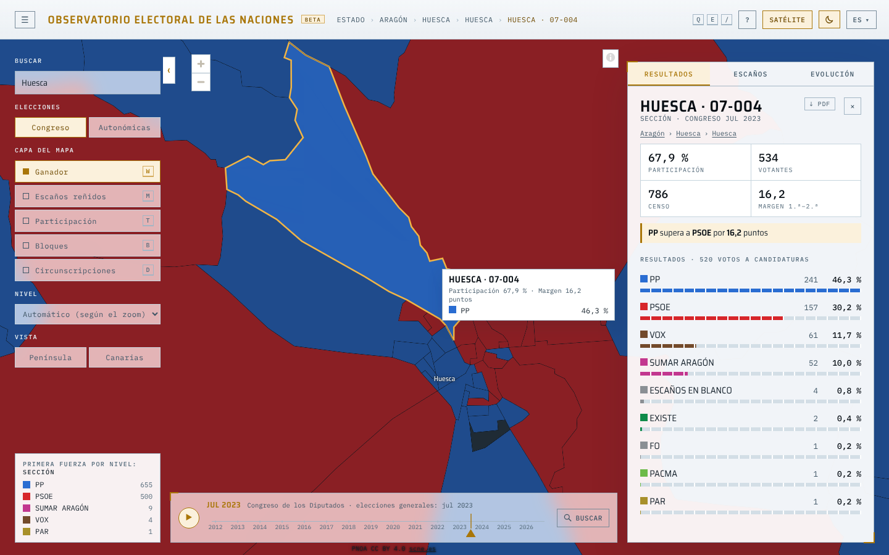
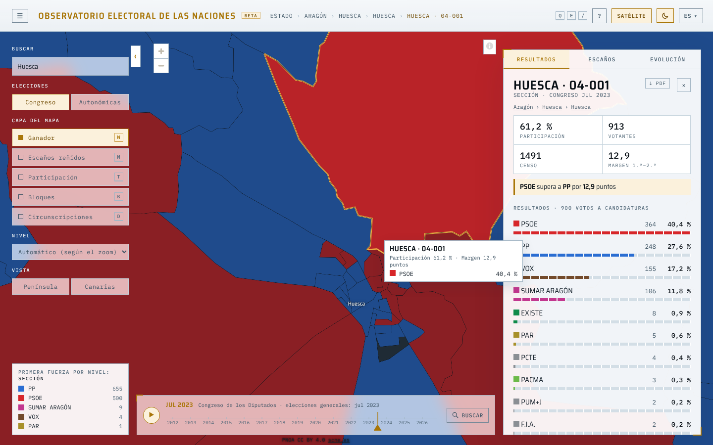
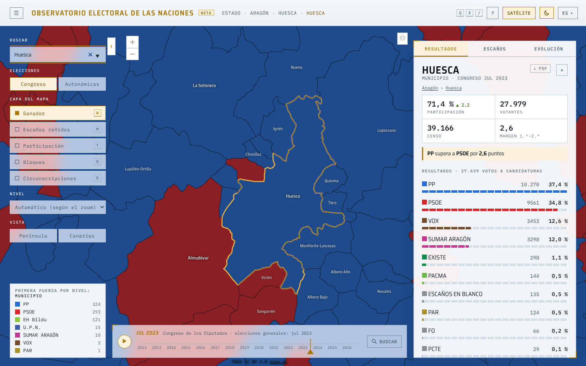
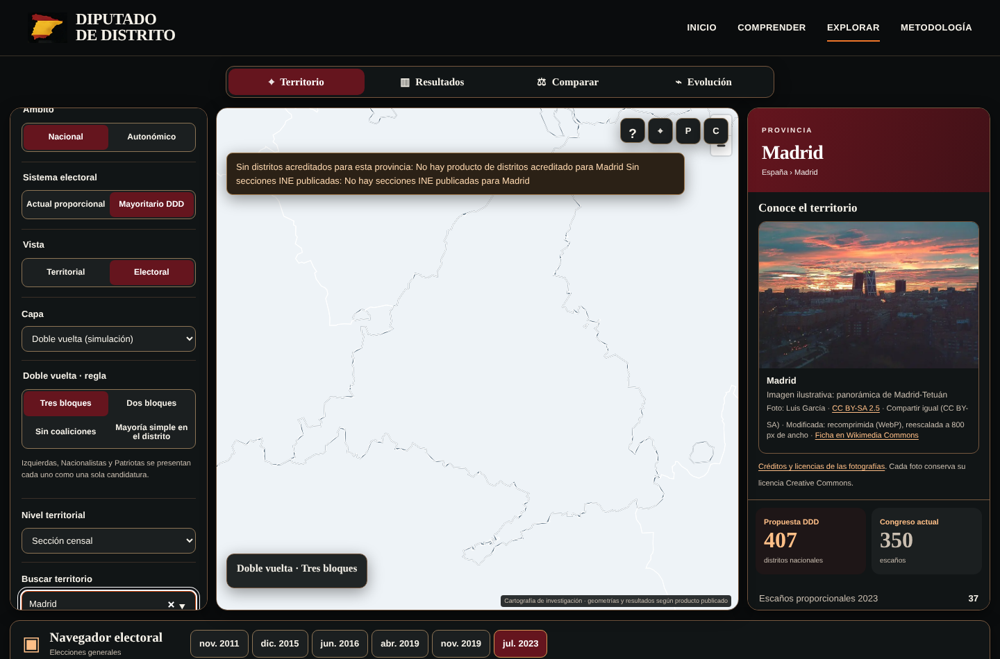
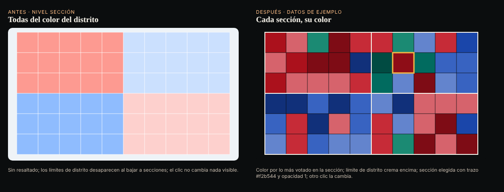

# T-458 · Diseño al detalle del mapa de la V4 (Explorar)

VERSIÓN: 1.2.0 · FECHA: 2026-11-24 · ESTADO: propuesta para aprobación del propietario
CAMBIOS 1.2.0: rehecho a partir de la referencia del propietario (el Observatorio, nazioenbehatokia.eus): comparación
  pantalla a pantalla, paleta y tonos de allí, panel con los datos arriba y sin foto, datos por sección del Observatorio
  con cuadre contra nuestro ZIP oficial; preguntas rehechas (incluye 5-7).
CAMBIOS 1.1.0: puntos (5) navegación por distrito, (6) color propio de cada sección y (7) interacción con secciones.
MOTIVO: comentarios del propietario vía Coordinador (24-11).
ANTERIOR: 1.1.0 en el commit a0bb74c y 1.0.0 en b90579e de esta misma PR (documento sin fusionar; sin copia en `legacy/`)

Objeto: `visor/v4/mapa/` (`index.html` 1.3.0, `explorar.js`, `explorar.css`, `dv.js`). Solo diseño; nada de código de
producto hasta que el propietario apruebe. Capturas: `antes_visor_actual.png` (nuestro visor servido en local),
`referencia/*.png` (el Observatorio, 24-11-2026, Huesca, solo para comparar) y láminas de `maqueta.html`.

## 0. La referencia: qué hace el Observatorio

| Pantalla | Observatorio | DDD hoy |
|---|---|---|
| Fondo y bordes | Fondo oscuro `#0C131A`; bordes oscuros finos (0,3 px sección, 0,6 px resto) | Fondo claro `#eef3f7`; bordes blancos |
| Relleno | Color propio del partido o del bloque, opacidad 0,88; 1 al pasar el ratón | Pasteles del tema oscuro aclarados un 55 %, opacidad 0,82-0,88 |
| Niveles | Selector «Automático (según el zoom)» y niveles fijos; el clic funciona en todos | Salto a secciones al acercar que oculta los distritos |
| Clic | Resalta (trazo `#F2B544` de 2,5 px, `feature-state` `sel`) y abre la ficha de ESE territorio | Sin resaltado; la ficha de sección da datos del distrito |
| Otro clic | Cambia la selección y la ficha (secciones 07-004 → 04-001 en las capturas) | Parece muerto |
| Paso del ratón | Etiqueta: nombre, participación, margen, más votado y % | No hay |
| Panel derecho | Arriba: nombre, nivel y elección, ruta clicable, 4 cifras (participación, votantes, censo, margen 1.º-2.º), titular «X supera a Y por N puntos», barras por candidatura | Arriba: foto con pie y licencia; 407/350; los datos, abajo |
| Leyenda | «Primera fuerza por nivel: sección» con el número de territorios por partido | Lista de bloques |
| Ruta | En la cabecera y en la ficha: Estado › Aragón › Huesca › Huesca › 07-004 | «Huesca › Distrito 4» en la ficha de sección |

Capturas «antes» del clic en distrito y en sección de nuestro visor: el entorno no alcanza diputadodedistrito.es y el
local no tiene los productos de distritos ni secciones (viven en R2 y se montan en P40). El comportamiento de antes sale del
código (§1) y se ilustra en las láminas; si hace falta la captura real, se monta el sitio con P40 en modo prueba
(pregunta 18).

## 1. Diagnóstico del código de hoy (`explorar.js`)
- **No hay resaltado en ningún nivel:** `S.selected` no lo pinta ninguna capa; fuentes sin `promoteId` ni `feature-state`.
- **El distrito se pierde al clicarlo:** `focus()` encuadra hasta zoom 12; `zoomend` (≥ 7,2) pasa solo a «Sección
  censal» y `prepareArea` oculta `dist-fill` y `dist-line`.
- **Con secciones visibles no se puede elegir distrito** (capas ocultas, sin límite de distrito encima).
- **Ficha de sección con datos del distrito:** «Ganador del distrito 2023» y la doble vuelta del distrito
  (`dvDist = obj.parentDistrict ?? obj.d`); ruta «Huesca › Distrito 4».
- **Secciones del color de su distrito** (`sec-fill` usa la expresión del distrito).
- **Colores difusos:** `bloques()` lee los tokens de `tokens-bloques.css`, que en tema oscuro dan pasteles para texto
  (`#ff8a80`, `#4fd1c5`, `#7fb2ff`); `aclarar()` los mezcla un 55 % con blanco; fondo claro y bordes blancos.

## 2. Propuesta

### 2.1 Regla de niveles (4, c)
Clicar un territorio muestra los datos de ESE nivel y nada más: España, comunidad, provincia, distrito (incluida la doble
vuelta) o sección. Entre niveles solo hay navegación (ruta clicable), nunca datos de otro nivel.

### 2.2 Mapa (1, a)
- Fondo del mapa `#0b0d0e` (el `--coal` de la web), «sin dato» `#2a3946`, bordes `#0b0d0e` (0,3 px sección, 0,6 px
  distrito); a nivel sección, el límite de distrito encima en crema `#f5f1e8` 1,5 px.
- Relleno con opacidad 0,88; 1 en el territorio bajo el ratón y en el elegido.
- Selección: trazo `#f2b544` 2,5 px.
- Bloques, 4 escalones por ventaja sobre el segundo (≤ 2, ≤ 5, ≤ 10, > 10 puntos; a más ventaja, más intenso):

| Bloque | ≤ 2 | ≤ 5 | ≤ 10 | > 10 |
|---|---|---|---|---|
| Izquierdas | `#f2707a` | `#e0303d` | `#c1121f` | `#8e0d17` |
| Nacionalistas | `#4fc1a8` | `#1e9c82` | `#00796b` | `#00544a` |
| Patriotas | `#6f95e8` | `#3f6fdb` | `#1d4fc0` | `#12368a` |
| Sin bloque | `#8a8f94` | | | |

- Capa «Partido más votado»: el color propio del partido, sin aclarar (la `PALETA` de hoy).
- Mismos valores en tema claro y oscuro (el mapa siempre es oscuro, como la web).

### 2.3 Panel derecho (b, 2, 3)
Arriba del todo, los datos de lo clicado: cabecera (nombre, nivel y elección, ruta clicable), 4 cifras, titular y barras;
después «De dónde sale este mapa». Fuera la foto, «Conoce el territorio», su pie y créditos, y el bloque 407/350.
La licencia no obliga a nada si no hay foto; si el propietario la conservara, una línea al final (autor, licencia,
modificada, enlace a créditos), que es lo que exigen CC BY y CC BY-SA.

### 2.4 Ficha por nivel
| Nivel | 4 cifras | Titular | Barras |
|---|---|---|---|
| Sección | participación, votantes, censo, margen 1.º-2.º | «X supera a Y por N puntos en esta sección» | votos por candidatura |
| Distrito | participación, votantes, censo, margen | ganador de la doble vuelta con la regla elegida | 1.ª y 2.ª vuelta (lo de hoy) |
| Provincia | participación, votantes, censo, distritos DDD | ganador / bloque y margen | votos y escaños 2023 |
| Comunidad / España | idem | idem | idem |

### 2.5 Navegación e interacción (5, 6, 7)
1. Capas de abajo arriba: relleno → bordes → límite de distrito (a nivel sección) → selección → paso del ratón.
2. `promoteId` (`s` en sección, id en distrito) y `feature-state` `{sel, hover}`.
3. Clic: elige lo visible del nivel activo; resalta; abre su ficha. Otro clic sustituye la selección. Clic fuera o `Esc`:
   sube al nivel padre.
4. Nivel «Automático (según el zoom)» por defecto, como la referencia, y niveles fijos en el selector. Al cambiar de nivel
   por zoom no se pierde la selección: un distrito elegido sigue resaltado a nivel sección. El clic en un distrito encuadra
   sin pasar el umbral de secciones.
5. Etiqueta al pasar el ratón: nombre, participación, margen, más votado y %.
6. Leyenda «Primera fuerza por nivel» con el número de territorios por bloque o partido.
7. Teclado: `sr-status` anuncia la selección; tabla y buscador eligen igual que el clic.

## 3. Datos por sección

### 3.1 Qué tenemos
| Dato | Dónde | Fuente | En la web |
|---|---|---|---|
| Geometría, CUSEC, municipio, distrito, población | `v2/datos/secciones/<prov>.geojson` (P40) | INE, seccionado 2025 (sha256 `55c9da7e…bcc4`) | Sí |
| Votos por mesa: censo, blancos, nulos, votos a candidaturas y por candidatura | Release `fuente-infoelectoral-02202307` | Interior, `02202307_MESA.zip`, sha256 `e78fc231326a03cf67bbec87b7100ea0c8c46859daa1b2a631c06daaaf1717f8` (contrato `configuracion/contratos_infoelectoral.yaml`) | No: solo sumado a distrito |
| Autonómicas por sección | Entradas de T-426 y paquetes P10 de R2 | Cada comunidad (Asturias, solo municipio) | No |

### 3.2 Qué sirve el Observatorio
- Por elección y provincia: `data/<AAAAMM>/sekzioa/<cpro>.json` (autonómicas: `data/autonomikoak/sekzioa/<elección>/<cpro>.json`);
  geometría en `geo/sekzioak/<año>/<cpro>.json` (2023 se dibuja con el seccionado 2024).
- Formato: `s` (siglas), `k` (color), `f` (familia), `b` (bloque), `r` = {CUSEC: [censo, votantes, votos a candidaturas,
  [[índice de candidatura, votos]…]]}.
- Sus fuentes declaradas: el mismo ZIP de Interior (mismo sha256, prefijo `e78fc231326a`) y el mismo seccionado 2025
  (`55c9da7e34d3`). No declara licencia para sus ficheros derivados.

### 3.3 Cuadre (hecho en local, 24-11-2026)
`data/202307/sekzioa/22.json` (Huesca, sha256 `f9364cfd94e5fa213c286134f0c94e4835ecdb4f43daf4a7e9f47b0ed162a0a3`)
contra nuestro ZIP con `herramientas/fuente_infoelectoral_mesas.convert` y el fichero 09:
- 286 secciones en ambos; votos por candidatura idénticos en las 286.
- Votantes = blancos + nulos + candidaturas y votos a candidaturas: idénticos en las 286.
- Censo: igual en 284; difiere en 2 (`2204801010`: 1713 frente a 1712; `2217201001`: 477 frente a 475). Sin averiguar
  qué columna de censo usa.

Conclusión: **nos vale como cuadre, no como fuente.** La fuente es nuestro ZIP oficial (ya en el repositorio, con
contrato y huella); el Observatorio sirve para contrastar un producto nuestro, provincia a provincia.

### 3.4 Qué falta
Un producto «resultados por sección» (por provincia: CUSEC → censo, votantes, blancos, nulos, votos por candidatura y
bloque), generado del ZIP con huella y servido como hoy los CSV de doble vuelta (índice `actual.json`, T-430), con el
Observatorio como cuadre. Geometría: decidir si se dibuja 2023 con el seccionado de la elección (como la referencia) o con
el de 2025 y las tablas de equivalencia de `configuracion/` (las secciones partidas, sin dato).

## 4. Ficheros que tocaría la implementación
`visor/v4/mapa/index.html`, `explorar.js`, `explorar.css`; `visor/v4/tokens-bloques.css` (o tokens propios del mapa);
el pie de foto de `visor/v2/galeria/galeria.js` deja de usarse en Explorar. Para §3: una herramienta nueva y su paso en
P40 (compartidos: turno del planificador). Cada fichero sube VERSIÓN con copia en `legacy/`.

## 5. Preguntas (con recomendación)

1. **Paleta.** ¿Se aprueban fondo oscuro, bordes oscuros, opacidad 0,88 y los 4 escalones por bloque de §2.2?
   Recomendación: sí.
2. **Escalones.** ¿4 por ventaja (≤ 2, ≤ 5, ≤ 10, > 10) o 2 (firme/ajustado a 5 puntos)? Recomendación: 4, como la referencia.
3. **Panel.** ¿Datos arriba (cabecera, 4 cifras, titular, barras) y fuera foto, pie, créditos y 407/350? Recomendación: sí.
4. **Foto.** ¿Fuera del todo o una línea al final? Recomendación: fuera del todo en Explorar (la galería sigue en su página).
5. **Regla de niveles.** ¿Cada clic, los datos de su nivel; entre niveles solo la ruta? Recomendación: sí.
6. **Ficha de sección mientras no haya producto por sección.** ¿Solo población, ruta y «sin escrutinio propio publicado»?
   Recomendación: sí, y quitar ya «Ganador del distrito» y la doble vuelta de la ficha de sección.
7. **Producto de resultados por sección** (§3.4) desde nuestro ZIP, con el Observatorio como cuadre. Recomendación: sí,
   Congreso 2023 primero.
8. **Geometría de 2023.** ¿Seccionado de la elección (2023, sin partidas) o 2025 con equivalencias? Recomendación: el de
   la elección, como la referencia; el de 2025 solo para los distritos DDD.
9. **Color propio de la sección** (6): bloque o partido más votado en la sección, con los escalones de §2.2; sin dato, gris.
   Recomendación: sí; nunca el color del distrito.
10. **Doble vuelta en la sección.** ¿Solo primera vuelta (votos y bloque) y la segunda en el distrito? Recomendación: sí.
11. **Nivel automático por zoom** con selección persistente (§2.5.4), como la referencia. Recomendación: sí; sustituye a la
    casilla «Detalle de secciones al acercar».
12. **Resaltado** `#f2b544` 2,5 px y opacidad 1. Recomendación: sí.
13. **Clic fuera o `Esc`** sube al nivel padre. Recomendación: sí.
14. **Etiqueta al pasar el ratón** (nombre, participación, margen, más votado). Recomendación: sí.
15. **Leyenda «Primera fuerza por nivel»** con recuentos. Recomendación: sí.
16. **Capas de medida** (participación; margen ya va en los escalones). Recomendación: participación cuando exista §3.4.
17. **Orden de trabajo.** Recomendación: PR 1 = mapa, panel e interacción sin datos nuevos (§2 salvo el color propio de
    la sección); PR 2 = producto por sección y su color.
18. **Capturas reales «antes»** del clic en distrito y sección: montar el sitio con datos (P40 en prueba o en local con R2).
    Recomendación: no; el diagnóstico del código basta y la PR 1 traerá capturas reales del después.
