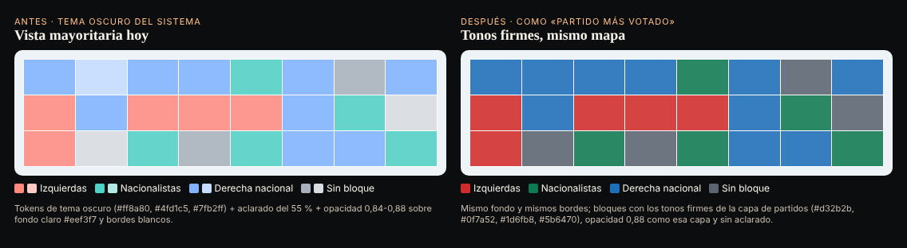
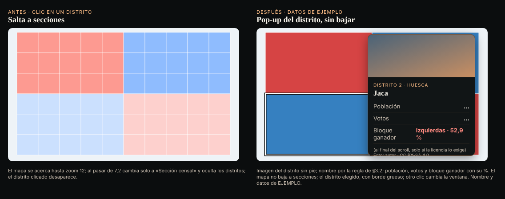

# T-458 · Diseño al detalle del mapa de la V4 (Explorar)

VERSIÓN: 1.4.0 · FECHA: 2026-11-25 · ESTADO: propuesta para aprobación del propietario
CAMBIOS 1.4.0: el propietario aprueba las preguntas 1-4 de la 1.3.0 tal como se recomendaban; añade (A) imagen del distrito, (B) nombre del
  distrito, (C) datos del distrito y (D) bloques (plan de cambio, sin implementar aquí).
CAMBIOS 1.3.0: corrección de rumbo del propietario (25-11): nuestro mapa, sin copiar otra web; colores firmes como la capa de
  resultados; panel con los datos arriba; clic en distrito con ventana emergente y sin bajar a secciones. Fuera por ahora: nivel de
  sección, producto de votos por sección, fondo oscuro y paleta ajena. Preguntas reducidas a las imprescindibles.
CAMBIOS 1.2.0 y 1.1.0 (commits 8baaf19 y a0bb74c de esta PR): versión sobre la web de referencia y puntos 5-7; sustituidas.
MOTIVO: comentarios del propietario vía Coordinador.
ANTERIOR: 1.3.0 en el commit cd24038 de esta misma PR (documento sin fusionar; sin copia en `legacy/`)

Objeto: `visor/v4/mapa/` (`index.html` 1.3.0, `explorar.js`, `explorar.css`). Solo diseño; ningún cambio de código de producto
hasta que el propietario apruebe. Capturas: `antes_visor_actual.png` (nuestro visor servido en local) y las láminas de
`maqueta.html` (`colores.png`, `panel.png`, `distrito.png`; datos de ejemplo).

## 1. Mapa: mismo mapa, colores firmes y sin pérdida de nitidez

### Por qué la vista mayoritaria (doble vuelta) se ve en azul difuso
La capa «Partido más votado» (la vista de resultados) pinta con la `PALETA` de partidos (`PP #1d6fb8`, `PSOE #d32b2b`, …),
opacidad 0,88 y sin mezclas: es la referencia de firmeza. La doble vuelta no:
1. `bloques()` toma los tokens de `tokens-bloques.css`; con el sistema en tema oscuro son pasteles pensados para texto sobre
   fondo oscuro: Patriotas `#7fb2ff`, Izquierdas `#ff8a80`, Nacionalistas `#4fd1c5`, Sin bloque `#a8b0bb`.
2. `aclarar()` los mezcla un 55 % con blanco cuando la ventaja es < 5 puntos (Patriotas pasa a `#c5dcff`).
3. Encima, la opacidad 0,88 deja ver el fondo azulado `#eef3f7`.

### Nitidez: revisado
- **Geometría de distritos del mapa** (`datos/<territorio>/distritos.geojson`, `herramientas/generar_datos_abiertos.py`): sin
  simplificación ni redondeo. No pierde resolución.
- **Geometría pública de la doble vuelta** (`herramientas/publicar_doble_vuelta.py`): Douglas-Peucker por anillo, 0,0005°
  (≈ 55 m), 5 decimales. Hoy el mapa no la dibuja (pinta la de `datos/`); si algún día la usara, simplificar por anillo
  deja huecos y solapes entre distritos vecinos: no usarla para dibujar.
- **Pérdida real de nitidez: los colores**, no la geometría (los tres puntos de arriba). La opacidad 0,88 es la misma que en la
  capa de partidos y se mantiene igual en las dos.

### Propuesta
- Bloques con tonos firmes de la familia de la capa de partidos, fijos en tema claro y oscuro (el mapa no cambia de tema):

| Bloque | Hoy en tema oscuro | Propuesta |
|---|---|---|
| Izquierdas | `#ff8a80` | `#d32b2b` (el de PSOE en la capa de partidos) |
| Patriotas | `#7fb2ff` | `#1d6fb8` (el de PP) |
| Nacionalistas | `#4fd1c5` | `#0f7a52` (el de EH Bildu) |
| Sin bloque | `#a8b0bb` | `#5b6470` |

- Sin aclarado: la ventaja ajustada (< 5 puntos) se dice en la ventana emergente y en el panel, no con un color lavado.
- Opacidad y bordes iguales a la capa de partidos (0,88; blanco 0,8 px).

## 2. Panel derecho (prioritario)

Hoy, de arriba abajo: cabecera, «Conoce el territorio» (foto, descripción, autor, licencia, cambios, créditos), tarjetas 407/350 y,
al final, los datos.

Propuesta, de arriba abajo:
1. Cabecera: nivel y elección, nombre, ruta (España › Huesca › Distrito 2).
2. **Cuatro cifras de lo seleccionado** (ver tabla).
3. Bloque de resultados de ese nivel (lo que hoy está abajo: escaños por partido en la provincia; 1.ª y 2.ª vuelta en el distrito).
4. «Resultados en tabla» y «De dónde sale este mapa».

Fuera: foto, «Conoce el territorio», pie, licencia, créditos y «407 / 350». Sin foto la licencia no obliga a nada.

| Selección | Cuatro cifras |
|---|---|
| España | escaños 2023 (350), distritos DDD, bloques ganadores con la regla elegida, población |
| Provincia | escaños 2023, distritos DDD, bloques ganadores con la regla, población |
| Distrito | población, votos y bloque ganador con su % (punto C, en este orden; sustituye a las cuatro cifras) |

Las cifras salen de lo que ya carga el visor (escaños oficiales, composición, CSV de doble vuelta); no hacen falta datos nuevos.

## 3. Clic en un distrito: ventana emergente, sin bajar a secciones

Hoy (`explorar.js`): el clic hace `focus()` hasta zoom 12; al terminar el zoom, `zoomend` (≥ 7,2, casilla «Detalle de secciones al
acercar») cambia solo a «Sección censal» y `prepareArea` oculta los distritos. No hay resaltado del distrito elegido.

Propuesta:
- Clic en un distrito: ventana emergente de MapLibre junto al punto: imagen del distrito sin pie (§3.1), nombre (§3.2) con
  «Distrito N · provincia», y en este orden **población, votos y bloque ganador con su %** (§3.3). Si la licencia de la imagen lo
  exige, una línea de atribución al final, abajo del scroll. El panel se actualiza con la misma ficha.
- El mapa no se acerca al distrito ni cambia de nivel; el distrito elegido lleva borde grueso (resaltado con `feature-state`).
  Otro clic cambia la ventana y el resaltado; clic fuera o `Esc` la cierra.
- Se retiran el salto automático a secciones (`zoomend`), la casilla «Detalle de secciones al acercar» y las opciones
  «Municipio (secciones)» y «Sección censal» del selector de nivel.

### 3.1 Imagen del distrito (A)
- **Fuente:** Wikimedia Commons, la imagen principal (propiedad P18 de Wikidata) del municipio que da nombre al distrito (§3.2);
  si no la tiene, la de su categoría de Commons. Es la misma fuente y el mismo tratamiento que la galería provincial de hoy
  (`visor/v2/galeria/catalogo.json`, T-325).
- **Cuántas:** 407 distritos del Congreso; los municipios que dan nombre son 295 distintos (`datos/distritos/nombres_congreso_*.csv`,
  columna `municipio_principal`). Los distritos de un mismo municipio (Madrid 1…N) comparten imagen. Las autonómicas, después.
- **Cómo se eligen:** herramienta nueva que, por municipio, toma la P18 y comprueba la licencia en la ficha de Commons; preferencia
  CC0 / dominio público (sin atribución), después CC BY y CC BY-SA. Sin P18 o con licencia no permitida: sin imagen (no se rellena
  con otra). Hoja de contactos para que el propietario descarte las que no quiera.
- **Cómo se guardan y sirven:** WebP de 800 px de ancho (la galería de hoy: 62 imágenes en 3,3 MB, unos 53 KB cada una), catálogo
  JSON con autor, licencia, enlace de origen, sha1 de Commons y sha256 del WebP. Unos 16 MB para 295 imágenes: en R2 (`mapas/`, lo
  sirve P40) mejor que en git. Carga diferida: solo al abrir la ventana.
- **Atribución:** con CC0 / dominio público, ninguna. Con CC BY / CC BY-SA es obligatoria (autor, licencia, indicación de cambios);
  va en una línea al final de la ventana, abajo del scroll, con enlace a la ficha de créditos.
- **Coste:** una ejecución de la herramienta (minutos) más la revisión de la hoja por el propietario; sin coste de servicio. Ojo:
  desde esta sesión `wikidata.org`, `commons.wikimedia.org` y `upload.wikimedia.org` no son accesibles; hay que pedir esos hosts en
  el entorno o hacerlo en un runner de GitHub.

### 3.2 Nombre del distrito (B)
Hoy existe `herramientas/generar_nombres_comunidades_nacional.py` (T-64), que escribe `datos/distritos/nombres_congreso_*.csv`
(407 distritos) con: un municipio → «municipio» o «municipio N» si está repartido; varios municipios → nombre de la comarca si todos
caen en una, si no «<más poblado> y entorno» (267 de 407 acaban en «y entorno»). El visor no los usa (`nombres: {}` en el índice).

Regla propuesta:
1. **Cabeza de comarca:** si el distrito contiene la capital de un partido judicial (unidad de T-64), ese municipio; si contiene
   varias, la más poblada.
2. **Si no**, el municipio más poblado del distrito (INE 2025, `datos/distritos/municipios_ine_2025.csv`, ya con sha256 en el
   MANIFEST).
3. **Municipio repartido entre distritos** (Madrid, Barcelona…): «Madrid 1…N», numerados de norte a sur y de oeste a este (regla
   que ya aplica la herramienta). Los nombres de barrios o distritos municipales no están en ningún fichero del repositorio (el
   seccionado del INE solo da el código del distrito municipal).
4. Sin «y entorno». Topónimos solo en español con `datos/distritos/toponimos_es.csv` (hoy falta, por ejemplo, Vitoria: sale
   «Vitoria-Gasteiz»).

Dato que falta: **la capital de cada partido judicial.** `configuracion/partidos_judiciales.csv` (Ley 38/1988, Anexo I) da municipio →
número de partido, pero no la capital: según el art. 4.4 de esa ley, la fijan las leyes de cada comunidad, y el partido se nombra por
ella (art. 4.5). Hay que incorporarla de una fuente oficial con huella (las leyes autonómicas de capitalidad o la relación del
Ministerio de Justicia o del CGPJ) antes de aplicar el paso 1.

### 3.3 Datos del distrito (C)
En este orden, todos de ficheros que el visor ya carga:
- **Población:** composición del distrito (`poblacion_distrito` de `nombres_congreso_*.csv` / propiedad del GeoJSON).
- **Votos:** votos a candidaturas del distrito: suma de `votos_1v` de sus filas en `detalle.csv` de la doble vuelta (en `resultados_doble_vuelta.csv`, `votos_1v` es solo el del ganador).
- **Bloque ganador con su %:** `bloque_ganador` y su cuota en la vuelta que decide (`cuota_ganador_2v` o `cuota_1v`), con la regla
  elegida.

## 4. Ficheros que tocaría la implementación
`visor/v4/mapa/index.html`, `explorar.js`, `explorar.css` y `visor/v4/tokens-bloques.css` (o tokens propios del mapa). Sin
herramientas, workflows ni datos nuevos. Cada fichero sube VERSIÓN con copia en `legacy/`.

## 5. Preguntas de la 1.3.0
Aprobadas por el propietario (25-11) tal como se recomendaban: colores de los bloques, ajustado solo en texto, cifras del panel
(con el cambio del punto C para el distrito) y retirada del nivel de sección.

## 6. Bloques (D): plan de cambio, no se implementa en esta PR

**Qué pide el propietario:** «Patriotas» pasa a «Derecha nacional»; «Izquierdas» se queda; los nacionalistas, de izquierda o de
derecha, en un bloque propio.

**Qué hay hoy** (`configuracion/bloques_partidos_2026-11-17.csv` y `bloques_partidos_autonomicas_2026-11-19.csv`): los nacionalistas
de izquierda y de derecha **ya están** en un solo bloque «Nacionalistas» (EAJ-PNV, CiU–Junts, CC, PDeCAT con EH Bildu, ERC, BNG, CUP…;
D-167, D-182). El cambio real es **solo el nombre** «Patriotas» → «Derecha nacional»; no se mueve ningún partido de bloque, así que
**ningún ganador ni porcentaje cambia**. (Si el propietario quiere además mover algún partido, se lista aparte.)

**Dos caminos:**
- **(a) Solo en la web:** el visor muestra «Derecha nacional» donde el dato dice «Patriotas» (`dv.js`, `explorar.js`,
  `comprender.html`). Una PR de visor y una publicación P40. Sin relanzar nada. El dato publicado sigue diciendo «Patriotas».
- **(b) En el origen (dato y web iguales):**
  1. PR de datos y herramientas: tablas `bloques_partidos_*` nuevas fechadas (sin tocar las aprobadas), `herramientas/doble_vuelta.py`
     (`BLOQUES`, `dv_B`), `herramientas/bloques_autonomicas.py` (`PAT`), P30 si lee la tabla por fecha, y los tests que lo citan
     (`test_t409_*`, `test_t418_p75`, `test_t419_publicar_doble_vuelta`, `test_t421_*`, `test_t427_p75_aut`, `test_visor_v4_*`).
     Decisión nueva (D-xx) que actualiza D-167/D-182.
  2. PR del visor (la misma que en (a), leyendo el nombre nuevo).
  3. Relanzar **P75 nacional** (52 provincias) y **P75 autonómicas** (las 16 con doble vuelta: aut11, aut18 y aut19 son `NO_APLICA`): cambian los ZIP y sus sha256.
  4. **P40** para publicar los CSV nuevos y el visor.
  Orden: 1 → 2 → 3 → 4, con CI en verde entre cada paso; 3 y 4 con autorización del propietario en el chat del Operador.

Recomendación: **(b)**, para que dato y web digan lo mismo; el coste es un P75 completo y un P40.

## 7. Preguntas

1. **Regla de nombre** de §3.2 (capital de partido judicial; si no, el más poblado; «Madrid 1…N»). Recomendación: sí, e incorporar
   antes las capitales de partido de fuente oficial con huella.
2. **Distritos de un mismo municipio:** ¿número («Madrid 4») o nombre de barrio? Recomendación: número (no hay fuente de barrios en el
   repositorio).
3. **Imágenes:** Wikimedia Commons por la P18 del municipio, preferencia CC0 / dominio público, servidas desde R2. Recomendación: sí.
4. **Distrito sin imagen con licencia válida:** ¿sin imagen o la de la provincia? Recomendación: sin imagen.
5. **Bloques:** ¿camino (a) solo web o (b) en el origen con P75 y P40? Recomendación: (b).
