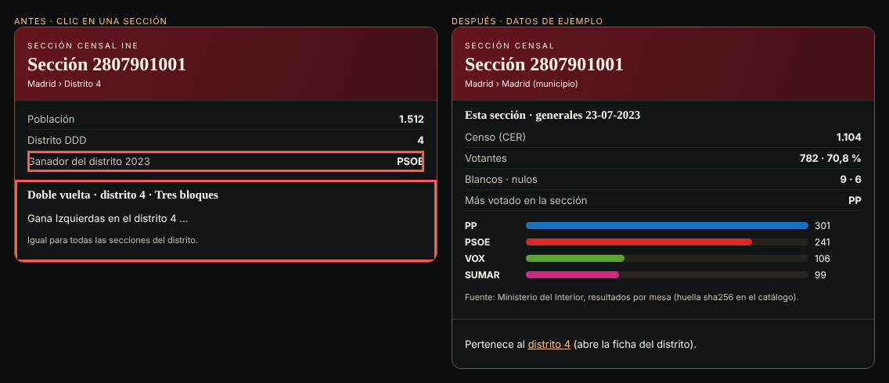
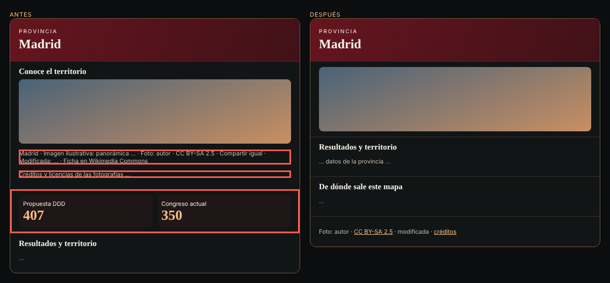

# T-458 · Diseño al detalle del mapa de la V4 (Explorar)

VERSIÓN: 1.0.0 · FECHA: 2026-11-24 · ESTADO: propuesta para aprobación del propietario
ANTERIOR: ninguna (fichero nuevo)

Objeto: `visor/v4/mapa/` (`index.html` 1.3.0, `explorar.js`, `explorar.css`, `dv.js`). Solo diseño: no se toca código
de producto hasta que el propietario apruebe este detalle. Las maquetas usan datos de EJEMPLO (`maqueta.html`); la
captura `antes_visor_actual.png` es el visor real servido en local (provincia de Madrid, tema oscuro del sistema).

## (4) Error de concepto: la ficha de una sección muestra datos del distrito

### Diagnóstico (código de hoy)
- `explorar.js` `renderDetail`, rama `kind==="seccion"`: la ficha lista «Distrito DDD» y **«Ganador del distrito 2023»**
  (`obj.winnerOfDistrict`), igual para todas las secciones del distrito.
- El bloque «Doble vuelta» se abre también al clicar una sección (`dvDist = obj.parentDistrict ?? obj.d`) y pinta la
  ficha **del distrito** con el título «Doble vuelta · distrito N».
- El color de la sección en la capa electoral es el del distrito (`sec-fill` usa la expresión del distrito; la leyenda lo
  dice: «el color electoral … es heredado del distrito DDD»).
- La migaja dice «Madrid › Distrito 4»: mezcla el nivel distrito en la cabecera de la sección.

### Regla propuesta
Cada nivel solo muestra sus propios datos: España → España; comunidad → comunidad; provincia → provincia;
distrito → distrito (incluida la doble vuelta); sección → sección. La única relación entre niveles es un **enlace** de
navegación («Pertenece al distrito 4», abre la ficha del distrito), nunca un dato del otro nivel en la ficha.

### Ficha de sección (después)
Cabecera «Sección censal · CUSEC · provincia › municipio». Bloque «Esta sección · <elección>»:
censo (CER), votantes y participación, blancos, nulos, votos por candidatura (barras) y más votado en la sección.
Población (padrón) en el bloque territorial. Fuente con huella. Sin dato propio → «Esta sección no tiene escrutinio
propio publicado» (nunca se rellena con el distrito).

### Qué datos por sección existen hoy

| Dato | Dónde está | Fuente | ¿Llega a la web? |
|---|---|---|---|
| Geometría, CUSEC, municipio, distrito, población (`s`, `m`, `d`, `p`) | `v2/datos/secciones/<prov>.geojson`, generado por P40 (`herramientas/generar_secciones_visor.py`) | INE, seccionado 2025 (partes con sha256 en `inputs/partes`) | Sí |
| Composición sección → distrito con población | `datos/composicion/*.csv`; M06 en R2 (`interno/estados/…/minimo-m06.zip`) | M06 del run vigente | Indirecto (propiedad `d`) |
| Votos por mesa del Congreso 23-07-2023 (censo, votantes, blancos, nulos, votos por candidatura, CUSEC) | Release `fuente-infoelectoral-02202307` (ZIP nacional por mesa); lo convierte `herramientas/fuente_infoelectoral_mesas.py` | Ministerio del Interior (Infoelectoral), huella en el contrato | **No**: solo se agrega a distrito |
| Votos por partido y distrito | `datos/resultados/nac*.csv`, `*_partidos.csv`; M07 dentro del M08 de R2 | Agregación del ZIP anterior | Sí, como distrito |
| Doble vuelta | `interno/doble-vuelta/…/doble-vuelta.zip` en R2 (P75) | M07 por distrito | Sí, **solo por distrito** (la doble vuelta es por definición del distrito) |
| Autonómicas por sección | Entradas de T-426 (`secciones.csv` de Murcia; nivel `seccion` en los MANIFEST de `datos/resultados/doble_vuelta_autonomicas/`) y paquetes P10 en `fuentes/por-territorio/…` de R2 | Fuente de cada comunidad | **No**: solo `*_partidos.csv` por distrito. Asturias (aut03) solo publica por municipio: sin dato por sección |

### Qué falta
1. Un producto «resultados por sección» (por provincia: CUSEC → censo, votantes, blancos, nulos, votos por candidatura),
   generado desde el ZIP de Interior con la misma huella, con su sha256 en el índice `actual.json` (T-430) y servido
   como hoy los CSV de doble vuelta. No existe en git, en R2 ni en la web.
2. Casar el seccionado de la elección (2023) con la geometría que pinta el visor (INE 2025): las tablas
   `configuracion/equivalencia_seccionado_ine_2026_a_2023.csv` y `equivalencia_secciones_congreso_2023.csv` clasifican
   cada sección en 1:1/recodificada, contenida o partida. Las partidas no tienen escrutinio propio en la geometría 2025.
3. Para autonómicas: el mismo producto desde las entradas por sección de T-426 (no Asturias).

## (1) Colores de la vista mayoritaria

### Causa del azul difuso
1. `bloques()` lee los tokens CSS `--izq/--nac/--pat/--sin`; con el sistema en tema oscuro `tokens-bloques.css` da
   los pasteles `#ff8a80`, `#4fd1c5`, `#7fb2ff`, `#a8b0bb`, pensados para texto sobre fondo oscuro, no para rellenar un
   mapa de fondo claro (`#eef3f7`).
2. `aclarar()` mezcla un 55 % hacia blanco los distritos con ventaja < 5 puntos.
3. `fill-opacity` 0,84-0,88 deja ver el fondo azulado.

### Paleta propuesta (los mismos valores en tema claro y oscuro; opacidad 1; borde blanco 0,8 px)

| Bloque | Firme (≥ 5 puntos) | Ajustado (< 5 puntos, mezcla 30 %) |
|---|---|---|
| Izquierdas | `#c1121f` | `#d45962` |
| Nacionalistas | `#00796b` | `#4da197` |
| Patriotas | `#0d47a1` | `#567ebd` |
| Sin bloque | `#4a5059` | `#80858b` |
| Sin dato | `#a8bac7` (sin cambio) | — |

Pendiente: la referencia «mapa actual» que ha de dar el propietario; si es otra, se ajustan los valores a ella.

## (2) Panel derecho

- Se queda la imagen, sin pie debajo.
- Fuera: «Conoce el territorio», la descripción («Imagen ilustrativa: …») y el bloque «Créditos y licencias …».
- Al final del scroll, una línea: «Foto: autor · licencia (enlace) · modificada · créditos (enlace a la ficha)».
  Es imprescindible: las fotos son CC BY / CC BY-SA, que exigen autor, licencia e indicación de cambios; la licencia 4.0
  admite darlos con un enlace a una página que los contenga (`v2/galeria/creditos.html`), las 2.x/3.0 piden el crédito
  «razonable al medio». Por eso se deja autor y licencia en la línea y el resto en la ficha.

## (3) Quitar «407 propuesta / 350»

Se retira el bloque `model-cards` (`#ddd-count`, `#current-count` y sus rótulos) de `index.html` y las líneas que lo
rellenan en `explorar.js`. Las cifras siguen donde son dato del nivel (la provincia: «Escaños proporcionales 2023»,
«Distritos propuestos DDD»).

## Ficheros que tocaría la implementación
`visor/v4/mapa/index.html`, `explorar.js`, `explorar.css`, `visor/v4/tokens-bloques.css` (o un token propio del mapa),
`visor/v2/galeria/galeria.js` (pie de foto) y, para (4), una herramienta nueva de resultados por sección y su paso en P40
(compartidos: turno del planificador). Cada fichero sube VERSIÓN con copia en `legacy/`.

## Preguntas (con recomendación)

1. **Referencia de color.** ¿Cuál es el «mapa actual»? Recomendación: aprobar la paleta de la tabla y ajustarla a esa
   referencia cuando llegue, sin cambiar la estructura (firme/ajustado).
2. **Ajustado.** ¿Mezcla del 30 % hacia blanco, o el color firme con rayado? Recomendación: mezcla del 30 % (legible,
   sin imágenes de trama en MapLibre).
3. **Tema oscuro.** ¿El mapa usa siempre los mismos colores, ignore o no el tema del sistema? Recomendación: sí; los
   pasteles quedan solo para texto y muestras sobre fondo oscuro.
4. **Ficha de sección sin producto por sección.** Mientras no exista (4.1), ¿la sección muestra solo geometría,
   población y el enlace a su distrito? Recomendación: sí, y quitar ya «Ganador del distrito» y la doble vuelta de la
   ficha de sección (arreglo inmediato, sin datos nuevos).
5. **Producto de resultados por sección.** ¿Se encarga (herramienta nueva desde el ZIP de Interior + paso en P40)?
   Recomendación: sí, empezando por las generales de 2023 del Congreso.
6. **Secciones partidas** entre el seccionado 2023 y el de 2025. Recomendación: sin dato propio y aviso «sección nueva
   de 2025; sin escrutinio propio»; sin repartir votos (como M07 7.4.0 con las contenidas 1:1).
7. **Color de las secciones** en la capa electoral. ¿Por su propio más votado (cuando exista el producto) o neutro?
   Recomendación: neutro hasta que exista; después, su propio más votado; nunca el color del distrito.
8. **Doble vuelta en la sección.** La doble vuelta se decide en el distrito. ¿La ficha de sección muestra solo la
   primera vuelta (votos por candidatura y bloque) o también una segunda vuelta con los finalistas del distrito?
   Recomendación: solo la primera vuelta; la segunda, en la ficha del distrito.
9. **Pie de foto.** ¿Línea mínima al final (autor, licencia, modificada, enlace a créditos)? Recomendación: sí; quitar
   título «Conoce el territorio» y descripción.
10. **407/350.** ¿Se quita el bloque entero, también en el ámbito autonómico (allí muestra escaños del parlamento)?
    Recomendación: sí, entero; esas cifras van en la ficha del nivel que corresponda.
11. **Migaja de la sección.** «Provincia › municipio» en lugar de «Provincia › Distrito N». Recomendación: sí.
