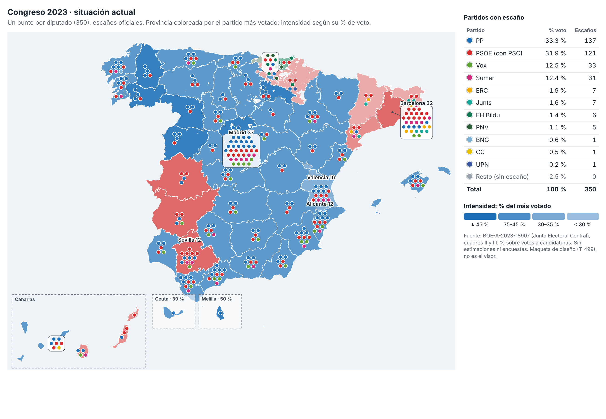

# T-499 · Diseño al detalle de la V5: situación actual, un punto por diputado

VERSIÓN: 1.0.1 · FECHA: 2026-11-25 · ESTADO: APROBADO por el propietario (25-11), todo como se recomienda
CAMBIOS 1.0.1: anotada la aprobación de las 7 preguntas de §6; sin cambios de diseño.
CAMBIOS 1.0.0: fichero nuevo.
MOTIVO: encargo del propietario (25-11): vista de situación actual del Congreso 2023 por provincia con un punto por diputado.
ANTERIOR: 1.0.0 en el commit 15b126a de esta misma PR (documento sin fusionar; sin copia en `legacy/`)

Solo diseño; ningún cambio de código de producto. Parte del diseño aprobado de la V4 (`../T458_mapa_v4/T458_DISENO_MAPA_V4.md`) y de
su implementación (PR #1014, T-459): misma paleta de partidos, opacidad 0,88, borde blanco 0,8-1 px, fondo `#eef3f7`, sin aclarados
salvo la escala de intensidad que se pide aquí.

Entregables de esta carpeta:
- `v5_nacional.png`: captura hecha en local con Playwright (Chromium, 1300 × 900, escala 2) de `maqueta.html`.
- `maqueta.html`: maqueta estática (SVG), con datos reales, generada por `generar_maqueta_v5.py`.
- `datos_v5_2023.json`: datos de la maqueta (escaños y votos por provincia), generados por `extraer_datos_v5.py`.
- Los dos scripts reproducen byte a byte el JSON y la maqueta (comprobado con `cmp`). No son producto: son la prueba del diseño.

## 1. Datos y fuente

| Dato | Fichero | sha256 |
|---|---|---|
| Escaños y votos de las candidaturas con escaño, por provincia | `configuracion/resultados_oficiales_congreso_2023.csv` (cuadro II de BOE-A-2023-18907) | `c7a636f2d4f08944b3a84cc9a6cd855bd5665eafd619d53a944e910e93475d8b` (= `sha256_csv` de su `.json`) |
| Votos a candidaturas por provincia (denominador del %) | XML de BOE-A-2023-18907, cuadros II y III (`https://www.boe.es/diario_boe/xml.php?id=BOE-A-2023-18907`) | `15950447a4cfe1b07ed44ead8514ed83ed87d859b2dcd7c03a47fd6a00f40323` (= `sha256_xml` del `.json`; descargado hoy, coincide) |
| Datos de la maqueta (derivados de los dos anteriores) | `docs/ESTUDIOS/T499_v5/datos_v5_2023.json` | `a003daf9cff1cc7d0063e6fbf5a5205e7983e94e6faa0be873d908b7f1e38efd` |
| Geometría provincial (la que ya usa la V4, Canarias ya desplazada) | `visor/v2/datos/provincias.json` | `effa1ed652de41001c6ce6f2975b08b15382174d7cb577aa748a90775e3a0c5c` |

Comprobaciones: 52 provincias; 350 escaños (PP 137, PSOE con PSC 121, Vox 33, Sumar 31, ERC 7, Junts 7, EH Bildu 6, PNV 5, BNG 1,
CC 1, UPN 1); la suma por provincia de los cuadros II y III (24 487 414 votos a candidaturas) es igual a la fila «Total estatal» del
BOE; el orden de provincias del BOE se casa con el CSV por los votos del PP en cada fila (0 desajustes).

**% de voto:** sobre **votos a candidaturas** (cuadros II + III). El cuadro I (votos válidos, en blanco, nulos) en el XML es una
**imagen**, no una tabla: sin transcribirlo no hay votos válidos con huella (pregunta 3).

Resultado: el partido más votado gana 40 provincias el PP, 10 el PSOE, 1 el PNV (Vizcaya) y 1 EH Bildu (Guipúzcoa).

## 2. Mapa

- **Provincia:** color del partido más votado (por votos, no por escaños), mezclado con blanco según su % (4 clases, no continuo,
  para que el color siga firme):

| % del más votado | Mezcla con blanco | Ejemplo PP |
|---|---|---|
| ≥ 45 % | 0 % | `#1d6fb8` |
| 35–45 % | 20 % | `#4a8cc6` |
| 30–35 % | 40 % | `#77a9d4` |
| < 30 % | 55 % | `#99bedf` |

- **Puntos:** uno por diputado, en el color pleno del partido, radio 4 px a zoom nacional, borde blanco 1,1 px (se distinguen sobre la
  provincia aunque sea del mismo partido). Malla hexagonal de 11 px de paso.
- **Racimo:** los puntos de cada provincia se agrupan en un racimo compacto centrado en el punto interior más alejado del borde (no
  repartidos por toda la provincia), ordenados por partido (más escaños primero) y por filas, para poder contarlos.
- **Etiqueta** «Nombre N» solo en provincias de 12 o más escaños; el resto, al pasar el ratón o tocar.
- Clic en la provincia: la ventana emergente de la V4 con la tabla de partidos (votos, %, escaños) de esa provincia.

### 2.1 Madrid, Barcelona y Valencia

Con 11 px de paso, a zoom nacional:

| Provincia | Escaños | ¿Cabe dentro? | Propuesta |
|---|---|---|---|
| Madrid | 37 | no (35 huecos) | racimo centrado que desborda un poco, sobre placa blanca al 85 % con borde fino |
| Barcelona | 32 | no (31 huecos) | racimo **desplazado al mar** con línea guía al centro de la provincia, sobre placa blanca |
| Valencia | 16 | sí | sin cambios |

Desbordan también, poco, Vizcaya (8) y Santa Cruz de Tenerife (7): llevan la misma placa. Al acercar, el paso de la malla crece con el zoom y,
cuando el racimo cabe dentro (se comprueba en la implementación), la placa y la línea desaparecen. Alternativa descartada: reducir los puntos a 9 px de paso para que todo quepa (se leen peor).

### 2.2 Recuadros

- **Canarias:** recuadro con línea discontinua al suroeste; la geometría de la V4 ya la trae desplazada, solo se añade el marco.
- **Ceuta y Melilla:** un recuadro cada una, ampliado ×8, con su punto y el % del más votado en el título.

## 3. Leyenda

Tabla junto al mapa (en el panel derecho de la V4, sección de resultados): punto de color, partido, % de voto estatal (sobre votos a
candidaturas) y escaños; una fila «Resto (sin escaño)» (2,5 %, 606 450 votos) y el total (350). Debajo, la escala de intensidad y la
fuente («BOE-A-2023-18907, Junta Electoral Central; sin estimaciones ni encuestas»).

## 4. Colores

Los de la capa de partidos de la V4 (`PALETA` de `visor/v4/mapa/explorar.js`), sin cambios: el mismo partido tiene el mismo color en
todas las capas.

| Partido | Hex | Escaños 2023 | % voto |
|---|---|---|---|
| PP | `#1d6fb8` | 137 | 33,3 % |
| PSOE (con PSC) | `#d32b2b` | 121 | 31,9 % |
| Vox | `#5fa335` | 33 | 12,5 % |
| Sumar | `#cf2a7b` | 31 | 12,4 % |
| ERC | `#f0ac00` | 7 | 1,9 % |
| Junts | `#18a99b` | 7 | 1,6 % |
| EH Bildu | `#0f7a52` | 6 | 1,4 % |
| PNV | `#2c5e36` | 5 | 1,1 % |
| BNG | `#7cb2d8` | 1 | 0,6 % |
| CC | `#e8c400` | 1 | 0,5 % |
| UPN | `#3a55a2` | 1 | 0,2 % |
| Resto | `#9aa3ad` | 0 | 2,5 % |

Fondo `#eef3f7`; bordes de provincia blancos; placas y líneas guía `#3a4652`; marcos de recuadro `#5b6470` discontinuos.
Pares cercanos: PNV/EH Bildu (comparten Vizcaya y Guipúzcoa) y BNG sobre provincias del PP (pregunta 4).

## 5. Implementación (cuando se apruebe; no se hace aquí)

- **Datos:** herramienta que genere `datos_v5_2023.json` (o CSV) de los cuadros II y III con la comprobación de sha256 del XML, como
  `herramientas/resultados_oficiales_boe.py`; test con valores literales del BOE (p. ej. Madrid 37 escaños, PP 1 463 183 votos).
- **Visor:** `visor/v4/mapa/index.html`, `explorar.js`, `explorar.css` (VERSIÓN + `legacy/`): capa de puntos (`circle` de MapLibre con
  radio por zoom), placas y líneas como capas propias, recuadros como mapas pequeños fijos, y la leyenda.
- **Pruebas en la web:** al abrir la PR que toca `visor/v4/`, P90 (`pruebas_web`, T-430 3a) sube la V4 de esa rama a
  `ddd-web-pruebas/<rama>/` = `https://pruebas.diputadodedistrito.es/<rama>/` (sin buscadores), con los datos de producción. Si el
  JSON nuevo va dentro de `visor/v4/mapa/`, viaja con la web y se ve en pruebas; si fuera a `datos.`, no se vería hasta publicar.
- **Producción:** el propietario la prueba en esa dirección; si la aprueba, se fusiona con la CI en verde y el Operador, con su permiso
  en ese mensaje, lanza **P40** en modo «solo sitio» (`production_run_id` vacío, no toca el registro del visor). Al fusionar, P90
  `limpiar_pruebas` borra la carpeta de la rama.

## 6. Preguntas

**Aprobadas por el propietario (25-11), todas como se recomienda.** La implementación la asigna el Planificador.

1. **Madrid, Barcelona y Valencia:** ¿racimo compacto con placa (Madrid desborda, Barcelona al mar con línea guía, Valencia dentro)?
   Recomendación: sí; al acercar, dentro y sin placa cuando quepan.
2. **Racimo o puntos repartidos** por la provincia: Recomendación: racimo ordenado por partido (se cuentan; repartidos no).
3. **Denominador del %:** votos a candidaturas (cuadros II + III, ya con huella) o votos válidos (exige transcribir el cuadro I, que es
   una imagen, y contrastarlo). Recomendación: votos a candidaturas, y decirlo en la leyenda.
4. **Colores:** la paleta de la V4 sin cambios, o retocar PNV/EH Bildu y BNG para separarlos más. Recomendación: sin cambios (mismo
   color en todas las capas); el borde blanco de los puntos ya los separa.
5. **Intensidad:** 4 clases (≥ 45, 35–45, 30–35, < 30 %) o escala continua. Recomendación: 4 clases, colores más firmes.
6. **Dónde vive el dato:** JSON en `visor/v4/mapa/` (se ve en pruebas sin publicar datos) o en `datos.`. Recomendación: en
   `visor/v4/mapa/`, generado por herramienta con test.
7. **Dónde va la V5:** una capa más del selector de la V4 («Situación actual · puntos») o vista propia. Recomendación: capa de la V4,
   activa por defecto en «Congreso · 2023 · Provincia».
